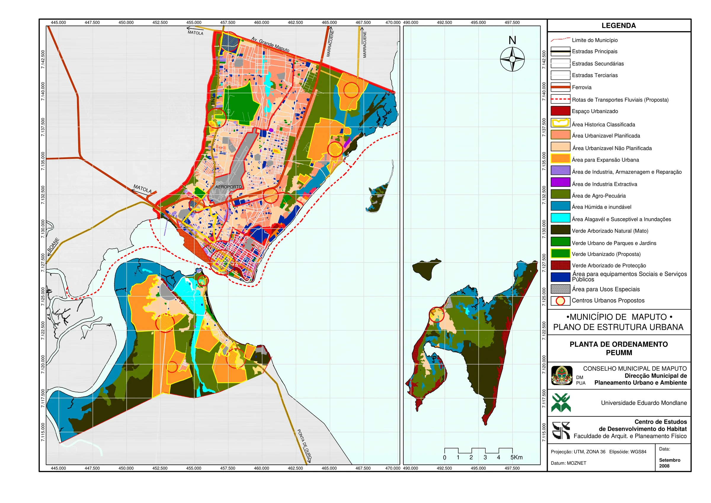
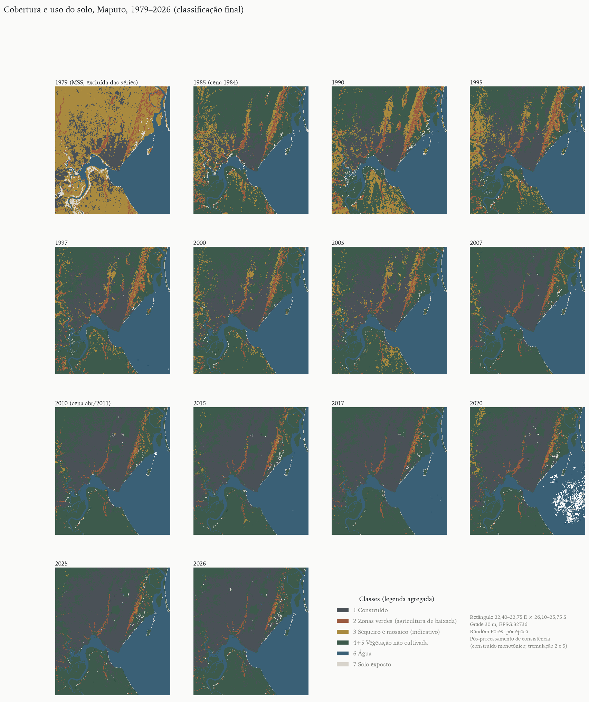
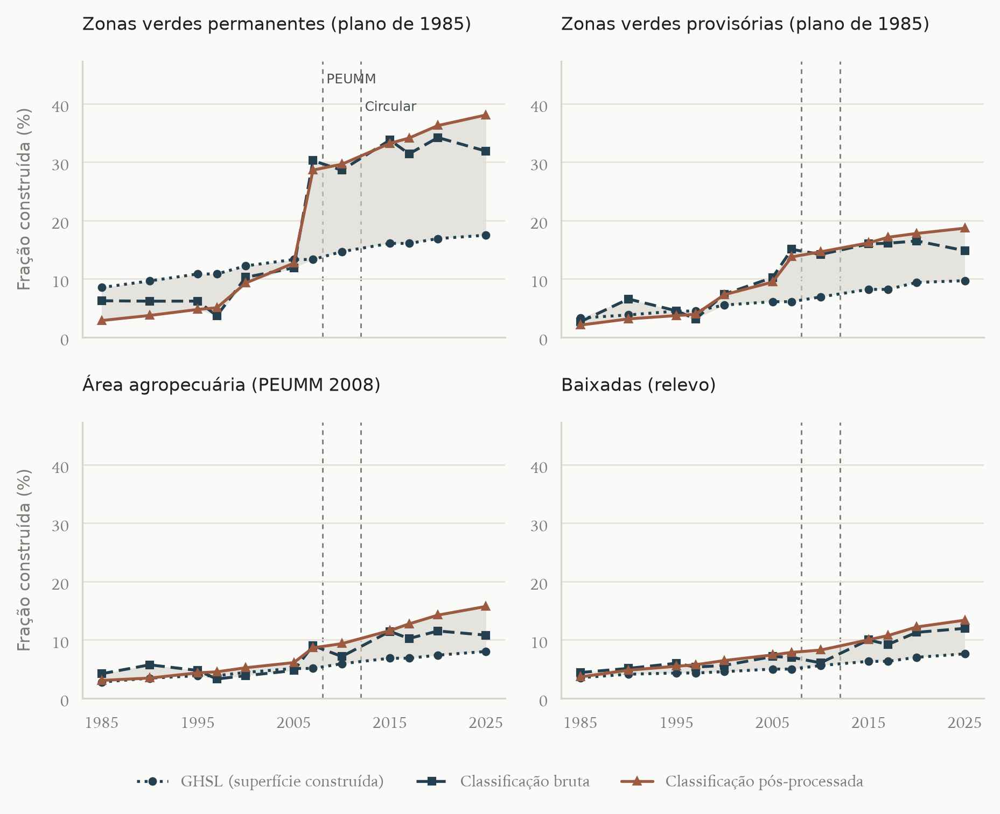
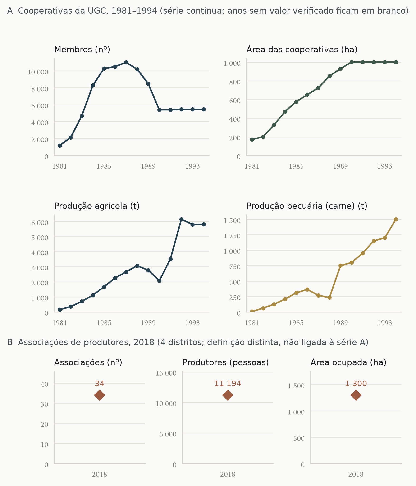
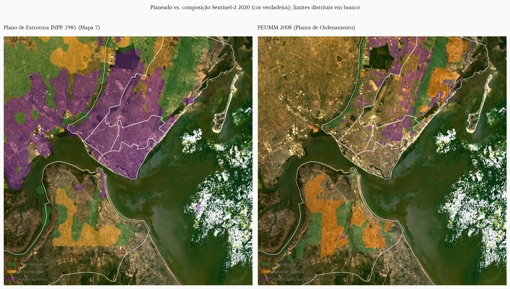

# Resumo

As zonas verdes de Maputo, cintura de hortas e machambas nos vales do Infulene e de Mahotas e na planície costeira de KaMavota, foram reconhecidas desde 1979 como base do abastecimento da cidade e citadas como exemplo de agricultura urbana protegida em África. Este artigo reconstitui a sua trajetória entre 1979 e 2026, combinando a história institucional e dos planos urbanísticos de Lourenço Marques e Maputo com um painel de imagens Landsat nos anos censitários e intercensitários, classificado por Random Forest e avaliado, para 2020, por amostra estratificada interpretada às cegas. Como a agricultura de baixada se separa mal da vegetação não cultivada a 30 m, a medida central é a fração construída dentro de perímetros independentes da classificação. Entre 1985 e 2025, a área construída da cidade cresceu de {{cid_cresc_ghsl}}% a {{cid_cresc_final}}%, conforme a estimativa; em 2025 estavam construídos entre {{r_perm_2025_min}}% e {{r_perm_2025_max}}% das zonas verdes permanentes do plano de 1985 e entre {{r_peumm_2025_min}}% e {{r_peumm_2025_max}}% da área agropecuária do plano de 2008, e a fração construída das baixadas mais que dobrou, com ocupação contínua depois da aprovação do plano de 2008. As séries de produtores indicam contração de dezenas de milhares nos anos 1980 para cerca de onze mil associados em 2018. A comparação com outras cidades mostra que o reconhecimento político da agricultura urbana em Maputo nunca se converteu em estatuto jurídico do solo. Argumenta-se que a cintura agrícola deve ser tratada como infraestrutura verde, pelo seu papel na renda, no abastecimento de folhosas e na drenagem das terras inundáveis.

**Palavras-chave:** agricultura urbana; zonas verdes; Maputo; uso do solo; sensoriamento remoto; planejamento urbano; segurança alimentar.

# Abstract

Maputo's green zones, a belt of vegetable gardens and smallholdings in the Infulene and Mahotas valleys and on the KaMavota coastal plain, have been recognised since 1979 as a basis for the city's food supply and are often cited as a protected urban agriculture system in Africa. This article reconstructs their trajectory from 1979 to 2026 by combining institutional and planning history, from colonial Lourenço Marques to present-day Maputo, with a Landsat image panel for census and intercensal years, classified with Random Forest and assessed, for 2020, with a blind stratified sample. Because lowland agriculture is poorly separated from uncultivated vegetation at 30 m, the main indicator is the built-up share within perimeters defined independently of the agricultural classification. Between 1985 and 2025 the city's built-up area grew by {{cid_cresc_ghsl}}% to {{cid_cresc_final}}%, depending on the estimate; by 2025, between {{r_perm_2025_min}}% and {{r_perm_2025_max}}% of the permanent green zones of the 1985 structure plan and between {{r_peumm_2025_min}}% and {{r_peumm_2025_max}}% of the agricultural zone of the 2008 plan were built up, and the built-up share of the lowlands more than doubled, with continued building after the 2008 plan was approved. Producer series point to a contraction from tens of thousands in the 1980s to about eleven thousand association members in 2018. Comparison with other cities shows that the political recognition of urban agriculture in Maputo never became a legal land-use status. We argue that the agricultural belt should be planned as green infrastructure, given its role in livelihoods, leafy-vegetable supply and the drainage of flood-prone land.

**Keywords:** urban agriculture; green zones; Maputo; land use change; remote sensing; urban planning; food security.

# 1 Introdução

As chamadas zonas verdes de Maputo são uma faixa de hortas, machambas e pequenas criações que acompanha os vales do Infulene e de Mahotas e as baixadas costeiras de KaMavota. Desde a independência de Moçambique elas foram tratadas ao mesmo tempo como base do abastecimento da capital, como reserva de terra para a expansão urbana e como estrutura ecológica de drenagem. Essa ambiguidade atravessa os planos urbanísticos, as políticas agrárias e o mercado de terras, e é o objeto deste artigo.

O caso tem peso próprio na literatura sobre agricultura urbana em África. A FAO apresentou Maputo como exemplo de cidade em que as zonas hortícolas foram protegidas e inscritas no ordenamento, com cerca de 13 000 horticultores em 2 300 ha nos vales do Infulene e de Mahotas [@fao_2012_l2, p. 72]. Estudos mais recentes descrevem outro quadro: associações que perdem membros e terra, conversão de canteiros em loteamentos e condomínios na Costa do Sol, salinização das baixadas costeiras e um município que interditou pedidos de "mudança de actividade" depois de sucessivos conflitos [@engel_2019, p. 48, 73; @durrnagel_2022_l1, p. 98, 109, 113]. A distância entre as duas leituras é, em parte, um problema de medida: as áreas atribuídas às zonas verdes variam, conforme a fonte e a definição, de 171 ha de cooperativas em 1981 a "mais de 47 000 ha" de produção familiar e cooperativa em 1986 [@christie_1996, p. 61; @engel_2019, p. 71].

Este artigo tem três objetivos. O primeiro é reconstituir a trajetória das zonas verdes de Maputo de 1979 a 2026, combinando a história institucional e urbanística com um painel de imagens orbitais nos anos censitários de Moçambique (1980, 1997, 2007 e 2017) e nos anos intercensitários quinquenais. O segundo é medir a conversão de áreas agrícolas em área construída, localizar as frentes de conversão e confrontá-las com os conflitos documentados e com o zoneamento dos planos. O terceiro é situar o caso no debate sobre o papel da agricultura urbana na redução da pobreza, na segurança alimentar e na prestação de serviços ambientais, comparando-o com experiências selecionadas em outras cidades africanas e em outros continentes.

A contribuição é dupla. Empiricamente, o artigo produz uma série espacialmente explícita e de definição constante para um objeto cujas estatísticas são fragmentárias e incompatíveis entre si. Analiticamente, mostra como o estatuto jurídico ambíguo das zonas verdes, protegidas nos textos e disponíveis na prática, organiza a sua erosão. A seção 2 apresenta o referencial teórico; a 3, a trajetória histórica; a 4, os planos urbanísticos de Lourenço Marques e Maputo; a 5, materiais e métodos; a 6, os resultados; a 7 discute o caso à luz da comparação; e a 8 conclui.

# 2 Agricultura urbana em cidades africanas: um debate em três tempos

## 2.1 Definição e genealogia

A agricultura urbana e periurbana é definida menos pela localização do que pela integração no sistema econômico e ecológico da cidade: usa recursos urbanos (terra, água residual, mão de obra, resíduos), abastece mercados urbanos e sofre as pressões próprias da cidade, como a competição pelo solo [@mougeot_2000]. Essa definição, consolidada nos anos 1990 em torno do IDRC e da rede RUAF, nasceu de uma agenda de reabilitação: contra a visão de que o cultivo na cidade seria um resquício rural destinado a desaparecer com a modernização, os estudos fundadores sustentaram que se tratava de estratégia de sobrevivência e de atividade comercial em expansão [@egziabher_1994; @prain_2010]. Parte dessa literatura associou o crescimento da prática às crises urbanas e ao ajuste estrutural [@bryld_2003], e mostrou que o cultivo urbano era antigo e ignorado pelas políticas [@rakodi_1988].

## 2.2 Pobreza e segurança alimentar: da promessa ao ceticismo

A promessa de que a agricultura urbana reduziria a pobreza e a fome urbanas foi posta à prova na década de 2010. Com inquéritos padronizados em onze cidades da África Austral, a rede AFSUN concluiu que a produção urbana de alimentos não era particularmente significativa para a maioria dos agregados, que dependiam sobretudo de supermercados e do comércio informal [@crush_2011a]; análises posteriores do mesmo conjunto não encontraram efeito protetor consistente da agricultura urbana sobre a insegurança alimentar dos mais pobres e sugeriram que ela beneficiava quem já tinha renda ou terra [@frayne_2014]. Em quinze países, a participação da agricultura urbana na renda dos agregados mostrou-se limitada, embora associada positivamente à diversidade da dieta [@zezza_2010]. Uma revisão sistemática de 35 estudos encontrou contributos substanciais apenas em alguns contextos, com a subsistência como motivação principal e retornos baixos [@poulsen_2015]; outra classificou a evidência quantitativa como de baixa qualidade e com resultados mistos [@warren_2015]. Na síntese organizada por Battersby e Watson, Crush e Riley observam que a promoção da agricultura urbana foi a principal intervenção municipal de segurança alimentar na África do Sul, sem evidência de que tenha alcançado os mais vulneráveis [@crush_riley_2019, p. 49], e Battersby e Haysom lembram que quem cultiva, em geral, não são os mais pobres [@battersby_haysom_2019, p. 58].

Esse ceticismo deslocou a pergunta: em cidades africanas, a insegurança alimentar é sobretudo um problema de acesso, e não de disponibilidade, e a agricultura urbana precisa ser lida no interior de sistemas alimentares em que o retalho informal e a governança local pesam mais do que a produção [@battersby_2011; @battersby_haysom_2019]. Três matizes, contudo, impedem que a conclusão cética seja generalizada. Primeiro, a participação varia muito entre cidades e bairros [@prain_2010]. Segundo, a agricultura urbana tende a dominar nichos de produtos perecíveis: em Dar es Salaam, 70% do amaranto consumido em 2021–2022 era produzido na própria região urbana, contra cerca de 90% das folhosas estimados nos anos 1990, queda que os autores atribuem à perda de terra agrícola [@wessels_2024, p. 3]. Terceiro, a medida de sucesso importa: o efeito sobre a segurança alimentar de cada agregado é distinto do contributo da cintura agrícola para o abastecimento da cidade e para o emprego dos produtores. Em Maputo, o inquérito da AFSUN de 2008, centrado nos bairros pobres, encontrou 22% de agregados que produziam algum alimento próprio e apenas 15% que o tinham consumido na semana anterior, e os autores advertiram que o papel da agricultura urbana nessas comunidades é facilmente exagerado [@raimundo_2014, p. 17–18]. O inquérito de 2014, de abrangência municipal, encontrou cerca de um em cada cinco agregados envolvidos em alguma forma de agricultura urbana, sem gradiente claro por quintil de renda [@raimundo_2018, p. 36–37]; já entre os produtores das associações, a agricultura é a principal fonte de renda de mais de dois terços dos agregados, ainda que insuficiente para adquirir a cesta básica [@engel_2019, p. xi, 64].

## 2.3 Serviços ambientais e riscos

A literatura recente reenquadrou a agricultura urbana como componente da adaptação climática: hortas de baixada e várzeas cultivadas retêm água de cheia, reduzem o escoamento superficial e mitigam ilhas de calor, ainda que as medições diretas em cidades africanas sejam escassas [@lwasa_2014; @lwasa_2015]. Em Kano, o cultivo de baixios funcionava como zona tampão de inundações, e os agricultores temiam a venda dessas terras para construção [@lynch_2001]. Os riscos são igualmente documentados: irrigação com águas residuais não tratadas, contaminação por metais e patógenos e uso intensivo de pesticidas [@prain_2010; @qadir_2010; @antwi_2016]. A orientação dominante é gerir o risco por barreiras múltiplas, e não proibir a prática [@mougeot_2000; @qadir_2010]. Em Maputo, os dois lados da questão concentram-se no vale do Infulene, que recebe o efluente da estação de tratamento de águas residuais e serve de bacia de drenagem da cidade [@reyestejada_2024, p. 187, 194].

## 2.4 Terra, posse e planejamento

O ponto de maior consenso é que a insegurança fundiária é a principal ameaça à agricultura urbana [@lynch_2001; @davies_2021; @fao_2012_l2]. Os governos africanos oscilaram entre atitudes proibitivas e acomodatícias, e a visão modernista do planejamento tendeu a excluir a agricultura do desenho da cidade [@mbiba_1994; @smit_2019, p. 96]. O caso de Maputo interessa justamente porque o socialismo pós-independência inverteu essa exclusão, inscrevendo a agricultura no projeto urbano, e porque a sua trajetória posterior permite observar o que acontece com essa inscrição quando o solo urbano passa a ter valor de troca. A pergunta deixa de ser se a agricultura urbana "contribui" para a segurança alimentar e passa a ser em que condições institucionais e fundiárias ela persiste.

# 3 Trajetória histórica das zonas verdes

## 3.1 Lourenço Marques e as suas margens (1876–1975)

Lourenço Marques cresceu sobre um planalto arenoso cercado de terras baixas alagáveis. Os primeiros planos lidaram com essas terras como problema sanitário: o plano de Hall, de 1876, previa o esgoto e o aterro do pântano, e o Projecto de Ampliação de António José de Araújo (1887, aprovado em 1888) traçou a malha ortogonal da cidade alta, drenou o pântano e protegeu de construção a encosta da Malanga [@pimentel_2013, p. 52–55; @mendonca_2018]. Ao longo do período colonial, a cidade de cimento e a cidade de caniço separaram-se, e as baixadas cultivadas pertenciam às margens: quintas de colonos e machambas africanas nos vales do Infulene e de Mahotas, fora do perímetro planejado. O Plano Geral de Urbanização de João António de Aguiar, aprovado em 1955, introduziu uma "zona de reserva" e uma "zona rural de protecção" de pelo menos 5 km em torno da cidade; é a primeira cintura formal, mas a sua função era conter e reservar o crescimento urbano, não proteger a agricultura [@pimentel_2013, p. 59–60; @uccla_2020]. O Plano Director de Mário de Azevedo (1969, aprovado em 1972) passou à escala regional, fez um inquérito ao caniço e zonou a área por vocação biofísica, prevendo a expansão para Mahotas e Machava e um parque linear de drenagem que não chegou a ser construído [@pimentel_2013, p. 61; @raposo_2018].

## 3.2 Socialismo e autoabastecimento (1975–1986)

Com a independência e a saída de até 200 000 colonos, quintas e machambas abandonadas foram ocupadas por famílias e grupos organizados [@reyestejada_2024, p. 191; @christie_1996]. Em 1979, a primeira Reunião Nacional das Cidades e Bairros Comunais ampliou os limites das cidades para incluir as zonas suburbanas e as zonas verdes, definidas como base do autoabastecimento urbano [@raposo_2018, p. 15; @christie_1996, p. 40]. Em maio de 1980 foi criado o Gabinete das Zonas Verdes, ligado à Presidência e transferido em 1982 para o Ministério da Agricultura [@christie_1996, p. 42, 48]. A resolução que o criou nunca foi publicada no Boletim da República, de modo que o gabinete operou sem base legal formal [@christie_1996, p. 42]; a data registrada em outra fonte é abril de 1980 [@mozhist_zonasverdes].

As cooperativas foram o eixo da política. Filiadas à União Geral das Cooperativas, criada em 1982–1983, passaram de 7 cooperativas e 500 membros em 1980 para 210 e 11 000 membros em 1987, com área própria de 725 ha e produção agrícola de 2 662 t naquele ano [@christie_1996, p. 58, 61]. O crescimento mais rápido coincidiu com a seca e a guerra de 1981–1984 [@christie_1996, p. 61]. As cooperativas eram, contudo, apenas uma parte do sistema: em 1988, o Gabinete estimava cerca de 60 000 agricultores familiares, 400 privados e 11 000 cooperados, num total de 71 400 produtores em 15 300 ha [@christie_1996, p. 52–53]. A cooperação italiana financiou, entre 1985 e 1993, a drenagem e a irrigação do Infulene, com 13 km de canais principais e 130 km de secundários [@christie_1996, p. 57]. O lado coercitivo do período também marcou as margens da cidade: a Operação Produção, de 1983, deslocou à força para o norte do país moradores considerados improdutivos [@reyestejada_2024, p. 191].

## 3.3 Ajuste, liberalização e associações (1987–1999)

A liberalização dos preços de hortícolas em 1985 e o Programa de Reabilitação Econômica de 1987 retiraram o apoio estatal e alteraram a economia das zonas verdes [@christie_1996, p. 15, 19]. Os membros das cooperativas caíram de 11 000 em 1987 para 5 450 em 1992–1994; em 1991, a assembleia da União autorizou o parcelamento individual e 145 cooperativas optaram por repartir a terra [@christie_1996, p. 61, 67]. A União reorientou-se para a avicultura, com uma fábrica de ração e uma incubadora de 80 000 pintos por semana a partir de 1989 [@christie_1996, p. 67]. As associações de produtores tornaram-se a forma organizativa dominante, e a produção do setor privado e familiar ganhou peso [@christie_1996, p. 53–54; @engel_2019, p. 71].

Esse é também o período em que se forma um mercado de terras nas zonas verdes. Num levantamento de 1991, Roth, Boucher e Francisco registraram que, das 34 parcelas alienadas pelos agregados da amostra, 65% o foram por despejo, em favor de agricultores privados, do Estado ou de associações, e menos de 12% dos despejados receberam compensação [@roth_1995, p. xviii]. Em 1995, 96,8% dos agricultores de cinco distritos não tinham título de uso da terra [@christie_1996, p. 54]. A Lei de Terras de 1997 confirmou a propriedade estatal do solo e o direito de uso e aproveitamento da terra (DUAT), mas foi vaga quanto à terra urbana, e a literatura associa-a à consolidação de um mercado ilegal de terrenos [@reyestejada_2024, p. 193–195].

## 3.4 Mercado de terras, infraestrutura e pressão imobiliária (2000–2026)

Três tipos de evento marcam o período recente. O primeiro são as cheias: a de 2000, a pior em mais de meio século no sul do país, sobrecarregou a drenagem do Infulene e levou ao abandono de parcelas; as obras de elevação da Avenida Joaquim Chissano agravaram as inundações e a salinidade a jusante [@reyestejada_2024, p. 194, 196]. O segundo são as infraestruturas: a Estrada Circular de Maputo, cujas obras começaram em 2012, tornou acessível à urbanização a planície costeira de KaMavota e elevou os valores da terra [@durrnagel_2022_l1, p. 98]; a ponte Maputo–KaTembe, inaugurada em novembro de 2018 [@ponte_katembe_2018], abriu a margem sul; a reabilitação da estação de tratamento do Infulene previu o reassentamento de cerca de 100 agricultores em Marracuene [@reyestejada_2024, p. 196–197]. O terceiro é a pressão imobiliária direta: os pesquisadores do projeto UFISAMO viram terra arável da Costa do Sol convertida em canteiros de obras de centros comerciais, hotéis e habitação de alta renda [@engel_2019, p. 48]; em KaMavota, a maioria das associações já cedera parte das suas áreas em 2021, e houve um caso de associação "falsa" criada com a identidade de membros para construir condomínios [@durrnagel_2022_l1, p. 108–109].

Em 2018 restavam 34 associações com 11 194 produtores em cerca de 1 300 ha, concentradas em KaMavota (816 ha) e KaMubukwana (422 ha); os seus presidentes relatavam perda de membros por envelhecimento, mudança de atividade e venda de espaço para construção [@engel_2019, p. 73]. Cerca de 70% dos produtores são mulheres e 42% têm mais de 65 anos [@engel_2019, p. 38, 64]. A salinização das baixadas costeiras, associada à subida do nível do mar, é outro fator de abandono [@engel_2019, p. 52; @durrnagel_2022_l1, p. 98, 112–113].

# 4 Os planos urbanísticos e as zonas verdes

## 4.1 Da cintura de proteção à zona agropecuária

A leitura dos planos mostra uma linha contínua de reserva de uma faixa periurbana, cuja função muda de plano para plano (Quadro 1). Os planos coloniais trataram a periferia como reserva de expansão e zona de proteção sanitária e paisagística; só depois da independência ela passou a ser pensada como espaço agrícola.

{{QUADRO_1_PLANOS}}

O Plano de Estrutura da Cidade de Maputo, preparado em 1985 pelo Instituto Nacional de Planeamento Físico, é o primeiro a mapear zonas verdes agrícolas (Figura 1). Propunha uma zona agropecuária de pequenas quintas ao longo do Infulene e junto à Costa do Sol, para abastecer a cidade e ocupar deslocados de guerra, e a sua legenda distinguia "zonas verdes permanentes" e "zonas verdes provisórias" [@pimentel_2013, p. 64]. Segundo o levantamento citado por Christie, eram 5 230 ha permanentes, dos quais apenas 1 190 ha demarcados, e 2 575 ha provisórios, nos quais o produtor deveria sair sem compensação quando começasse o projeto urbano [@christie_1996, p. 46]. O plano nunca foi aprovado formalmente, e o de 1969 continuou a ser a referência da gestão urbana [@pimentel_2013, p. 64]. A classe das zonas provisórias institucionalizou desde a origem a ideia de que parte da cintura agrícola era, na verdade, solo urbano em espera.

O Plano de Estrutura da Área Metropolitana de Maputo (1999), elaborado por consultores com financiamento do Banco Mundial, também nunca entrou em vigor, e os textos consultados não tratam da agricultura [@pimentel_2013, p. 65–66].

## 4.2 O PEUMM de 2008: protegidas no texto, disponíveis na prática

O Plano de Estrutura Urbana do Município de Maputo (PEUMM), de 2008, é o instrumento em vigor. O seu regulamento cria a classe "Espaço para Actividade Agrícola", representada na planta de ordenamento como "Área de Agro-Pecuária" (Figura 2). O artigo 11 declara esses solos "exclusivamente dedicados à agricultura" e justifica a sua proteção pela produção alimentar e pelo equilíbrio ecológico, mas, no mesmo artigo, admite edifícios, aterros e escavações ao serviço da atividade; o artigo 74 lista os usos que podem ser autorizados, incluindo, na alínea (e), unidades hoteleiras, em lotes de pelo menos 10 000 m² [@pimentel_2013, Anexo III, p. 9, 31–32]. O próprio diagnóstico do plano reconhece que, "por ausência de regulamentação específica", construções, aterros e escavações destruíam terras agrícolas [@pimentel_2013, Anexo III, Vol. I, p. 185]. As baixadas cultivadas sobrepõem-se ainda à estrutura ecológica municipal (áreas húmidas e inundáveis), cujo regime o plano remete para a lei geral [@pimentel_2013, Anexo III, p. 9, 32–33].

O extrato do plano consultado não traz a área da classe agrícola (o quadro de áreas está em branco). A vetorização da planta de ordenamento georreferenciada neste estudo dá {{env_peumm_area}} ha na parte continental da cidade. Para comparação, Jenkins estimava que a terra em agricultura urbana ocupava 26% da área urbana em 2013, segundo Reyes Tejada e coautores [@reyestejada_2024, p. 196]. A planta de ordenamento coloca a classe agropecuária ao lado de "áreas para expansão urbana" e de "áreas urbanizáveis não planificadas", sem regra de prevalência explícita entre elas. Um plano parcial posterior, o do bairro Luís Cabral, na margem do Infulene, é mais preciso: classifica espaços agrícolas de produção e espaços a recuperar para a agricultura [@cmm_2021a, p. 61–62].

## 4.3 O quadro nacional e a revisão em curso

O quadro nacional avançou mais do que o municipal. A Política de Urbanização de 2024 identifica a "rápida conversão de terra agrícola em solo urbano intensivo" como problema e estabelece como ação estratégica integrar a agricultura urbana nos instrumentos de ordenamento do território, mapeando as áreas propícias [@mocambique_2024, p. 2784, 2817]. O Regulamento do Solo Urbano, de 2006, impede a aquisição de novos DUAT em zonas de proteção parcial, como as margens de cursos de água, ressalvados os direitos adquiridos [@mocambique_2006]. Em sentido contrário, os instrumentos de infraestrutura tratam a cintura agrícola como reserva: o plano de transportes da Grande Maputo, de 2014, usa a "Greenbelt" como bacia de retenção e prevê uma variante da EN1 ao longo dela, admitindo que "alguma terra agrícola" seria afetada, e indica Marracuene e Boane, hoje agrícolas, como áreas de crescimento [@jica_2014, p. 28, 45]. O financiamento do Banco Mundial ao Projecto de Transformação Urbana de Maputo inclui um plano espacial urbano, bacias de detenção e a revisão do plano de KaTembe, sem menção à agricultura [@ida_2024, p. 5, 7]. Em setembro de 2026, o Conselho Municipal anunciou a revisão do PEUMM; a comunicação pública fala em densificação, expansão, mobilidade e proteção ambiental, mas não em agricultura [@clubofmozambique_2026].

# 5 Materiais e métodos

## 5.1 Área de estudo e unidades de análise

A análise cobre um retângulo de 35 × 39 km (32,40–32,75° E; 25,75–26,10° S) que contém a parte continental da Cidade de Maputo, a margem da Matola no vale do Infulene e o sul de Marracuene, numa grade de 30 m em projeção UTM 36S. As unidades de agregação são os sete distritos municipais e os 64 bairros da base administrativa oficial de 2025 [@ocha_codab_2025]. O distrito de KaNyaka (ilha de Inhaca) fica fora da área.

## 5.2 Épocas e imagens

As épocas seguem os anos dos recenseamentos gerais de Moçambique (1980, 1997, 2007, 2017) e os anos intercensitários quinquenais: 1980, 1985, 1990, 1995, 1997, 2000, 2005, 2007, 2010, 2015, 2017, 2020, 2025 e 2026. A fonte principal são as composições geomedianas anuais do Digital Earth Africa, que combinam todas as observações Landsat livres de nuvem de cada ano e trazem medidas de variabilidade intra-anual [@deafrica_geomad]. Essas medidas são úteis aqui, porque as hortas de baixada, com ciclos curtos e sucessivos, variam muito ao longo do ano, ao contrário de telhados, matas ou capinzais.

Três épocas exigiram substituição (Quadro 2). Não há imagem Landsat utilizável de 1980 para a área; a época censitária é representada por uma cena Landsat 3 MSS de 9 de junho de 1979, de 60 m e quatro bandas. A composição de 1985 cobria apenas 30% da área e foi substituída pela cena Landsat 5 TM de 1.º de junho de 1984. A composição de 2010 apresentava faixas de falha do sensor Landsat 7 e foi substituída pela cena Landsat 5 de 9 de abril de 2011, fora da estação seca. Para 2026 ainda não existe composição anual, e usou-se a mediana de 12 cenas Landsat 8 e 9 de maio a agosto de 2026 [@usgs_landsat_c2].

{{QUADRO_2_EPOCAS}}

## 5.3 Legenda e classificação

A legenda tem sete classes: (1) construído; (2) agricultura de baixada, que corresponde às zonas verdes no sentido estrito, isto é, hortas irrigadas e machambas em solos hidromórficos de vales e baixadas costeiras (*machongo*); (3) agricultura de sequeiro e mosaico, com machambas de milho e mandioca em interflúvios arenosos e pousios curtos; (4) vegetação arbórea e arbustiva, incluindo mangal; (5) herbácea e zonas húmidas não cultivadas; (6) água; (7) solo exposto e areia. Cada época foi classificada por um modelo Random Forest próprio [@breiman_2001], com as bandas de reflectância, os índices NDVI, NDBI, MNDWI e BSI, as medidas de variabilidade da geomediana quando disponíveis e três atributos de relevo do Copernicus DEM (altitude, declive e posição topográfica), que separam as baixadas cultivadas dos interflúvios [@copernicus_dem].

As amostras de treino foram construídas sem digitalização manual. Para a época âncora de 2020 tomaram-se os píxeis em que concordam os mapas globais ESA WorldCover e Impact Observatory/Esri [@zanaga_2022; @karra_2021] e, para a classe construída, também a superfície construída do GHSL [@pesaresi_2023], além dos polígonos de uso agrícola do OpenStreetMap. Os píxeis agrícolas foram separados em baixada e sequeiro pela altitude e pela posição topográfica. As amostras de 2020 foram propagadas para as demais épocas apenas quando a assinatura espectral se manteve estável e quando eram coerentes com a série de área construída do GHSL [@pesaresi_2023]. Nas épocas até 2005 foram acrescentadas amostras dos mapas de uso do solo de Maputo de 1982, 1991 e 2001, produzidos por fotointerpretação de fotografias aéreas [@henriques_2023]. O mapa de 1979, de resolução e bandas mais limitadas, foi tratado como estimativa de ordem de grandeza. Os mapas receberam um filtro modal 3 × 3 e, em seguida, um pós-processamento temporal aplicado ao conjunto das treze épocas de 1985 a 2026, com três regras: (i) um píxel classificado como construído numa época só é mantido como tal se também estiver construído em pelo menos duas das três épocas de uma janela centrada nela (deslocada nas extremidades da série); (ii) a partir da primeira época em que é confirmado, o píxel permanece construído, de modo que a série construída é não decrescente por construção; (iii) alternâncias isoladas entre agricultura de baixada e vegetação herbácea numa época intermediária são substituídas pela classe das épocas vizinhas. O pós-processamento alterou entre {{pp_min_pix}} e {{pp_max_pix}} píxeis por época. Como a regra (ii) acumula os erros de comissão confirmados, os resultados centrais são apresentados também com a classificação bruta, sem pós-processamento, e com o GHSL, que é independente deste estudo (seção 5.4).

## 5.4 Avaliação

A exatidão foi avaliada em três níveis. O primeiro é interno: erro *out-of-bag* dos modelos e validação cruzada em blocos espaciais de 3 km nas épocas de 2000, 2011 e 2020, que mede a capacidade de reproduzir os rótulos de treino. O segundo é a coerência externa com o GHSL (área construída, 1975–2025), com os mapas globais de terra agrícola e com os mapas fotointerpretados de 1982, 1991 e 2001 [@henriques_2023]. O terceiro é uma amostra aleatória estratificada de {{val_n}} pontos sobre o mapa de 2020, com a qual se estimaram a exatidão e as áreas ajustadas com intervalos de 95% segundo Olofsson e coautores [@olofsson_2014]. Os pontos foram rotulados às cegas, sem acesso ao mapa, por interpretação de recortes de composições Sentinel-2 de 10 m e Landsat de 30 m. A interpretação foi feita por um agente automático de análise de imagens, instruído com a legenda e isolado dos dados de classificação; {{val_conf_baixa}} dos {{val_n}} rótulos ({{val_conf_baixa_pct}}%) foram marcados como de baixa confiança. A avaliação refere-se apenas a 2020, e uma revisão humana de uma subamostra está entre os passos pendentes do estudo.

Na área total do estudo, a amostra mostrou que a classe construída é confiável (exatidão do usuário {{val_ua_1}} e do produtor {{val_pa_1}}), mas que a agricultura de baixada não se separa bem da vegetação não cultivada: a exatidão do usuário da classe 2 foi {{val_ua_2}} e a do produtor, {{val_pa_2}}. Restrita à cidade, a área ajustada da classe 2 em 2020 é de {{val_area_aj_2}} ± {{val_area_aj_2_ic}} ha, um intervalo compatível tanto com a área das associações quanto com o dobro dela. Sem os rótulos de baixa confiança ({{val2_n}} pontos), a exatidão do usuário fica em {{val2_ua_1}} para o construído e {{val2_ua_2}} para a classe 2. Parte do problema está na própria referência, já que canteiros de 2 a 4 m² [@engel_2019, p. 48] e machambas médias de 0,3 ha [@reyestejada_2024, p. 187] não são visíveis mesmo a 10 m, mas o resultado impõe cautela. Por isso a métrica central deste artigo não é a área mapeada de zonas verdes, e sim a **ocupação por construção** — a classe validada — dentro de perímetros definidos de forma independente da classificação agrícola: (i) as baixadas, definidas pelo relevo (altitude inferior a 15 m e posição topográfica côncava), onde se concentram os solos hidromórficos cultivados; (ii) as zonas verdes permanentes e provisórias do Plano de Estrutura de 1985; e (iii) a classe agropecuária do PEUMM de 2008. Para cada perímetro e época, a fração construída é estimada de três formas: pela classificação bruta, pela classificação pós-processada e pela fração de superfície construída do GHSL [@pesaresi_2023]. O GHSL mede a área efetivamente coberta por edificações e por isso dá os valores mais baixos; a classificação mede o tecido construído, com quintais e arruamentos. Os resultados são apresentados como o intervalo entre as três estimativas, e as conclusões apoiam-se apenas nas tendências em que as três concordam. O ano final dos números é 2025; a composição de 2026, uma mediana de cenas de poucos meses, é usada só no painel visual. A série da classe 2 é apresentada como indicativa.

## 5.5 Métricas e cruzamentos

A partir dos mapas calcularam-se a área por classe, época, distrito e bairro; matrizes de transição entre épocas consecutivas; a taxa anual de conversão de área agrícola em construída; e o ano da primeira conversão de cada píxel. As zonas verdes do Plano de Estrutura de 1985 e a classe agropecuária do PEUMM de 2008 foram georreferenciadas por pontos de controle e vetorizadas, o que permite comparar o zoneamento planejado com o uso observado. Os conflitos documentados na literatura e na imprensa foram compilados; {{conflitos_geo}} deles puderam ser localizados de forma aproximada no mapa e servem apenas de referência qualitativa. As séries de produtores, área e produção foram compiladas com fonte, página e definição espacial de cada valor, sem interpolação nem soma entre definições distintas.

# 6 Resultados

## 6.1 A expansão urbana, 1985–2025

A área construída da parte continental da cidade cresceu entre {{cid_cresc_ghsl}}% e {{cid_cresc_final}}% de 1985 a 2025, conforme a estimativa: {{cid_cresc_ghsl}}% pela superfície construída do GHSL, {{cid_cresc_bruto}}% pela classificação bruta e {{cid_cresc_final}}% pela classificação pós-processada (Figura 3). A amplitude do intervalo vem sobretudo de 1985, representado por uma única cena de junho de 1984, em que o construído é subdetectado; a partir de 1990, com composições anuais, a classificação pós-processada indica um crescimento de {{cid_cresc_1990_2025_final}}% até 2025. O crescimento concentrou-se no norte de KaMubukwana (Magoanine, Zimpeto) e, a partir dos anos 2010, na planície costeira de KaMavota e em KaTembe, depois da ponte. Como referência para a época censitária de 1980, os mapas fotointerpretados de 1982, que cobrem {{luco_cobertura_pct}}% da cidade, registram {{luco1982_construido}} ha construídos e {{luco1982_agri}} ha agrícolas nessa área de cobertura [@henriques_2023]; outros {{luco1982_excluido}} ha de classes ambíguas nessa legenda (residencial de baixa densidade, vias, equipamentos) não foram atribuídos a nenhuma das nossas classes, de modo que o construído de 1982 está subestimado.

## 6.2 A ocupação das zonas agrícolas planejadas e das baixadas

A medida mais robusta do avanço urbano sobre as zonas verdes é a fração construída dentro de perímetros que não dependem da classificação agrícola (Tabela 1 e Figura 4). Em todos os perímetros e nas três estimativas, essa fração pelo menos dobrou entre 1985 e 2025.

{{TABELA_1_ENVELOPES}}

Nas zonas verdes permanentes do Plano de Estrutura de 1985 ({{env_perm_area}} ha na cidade, segundo a vetorização do mapa georreferenciado), a fração construída em 2025 estava entre {{r_perm_2025_min}}% (GHSL) e {{r_perm_2025_max}}% (classificação pós-processada). Só {{env_perm_pct_em_baixada}}% dessas zonas ficam nas baixadas definidas pelo relevo; o restante está em terrenos mais altos, onde a ocupação foi mais rápida. Na cidade, as zonas provisórias, que o plano destinava à futura expansão urbana, tinham em 2025 uma fração construída menor (entre {{r_prov_2025_min}}% e {{r_prov_2025_max}}%); no conjunto do mapa de 1985, que inclui a Matola, a relação inverte-se ({{bbox_perm_2025}}% nas permanentes contra {{bbox_prov_2025}}% nas provisórias, classificação pós-processada). Dada a incerteza da vetorização das duas categorias, que se distinguem no original apenas pela densidade do pontilhado, não se pode afirmar que a expansão tenha seguido ou invertido a hierarquia do plano.

Na classe agropecuária do PEUMM de 2008 ({{env_peumm_area}} ha), a fração construída passou de {{r_peumm_2010_min}}–{{r_peumm_2010_max}}% em 2010 para {{r_peumm_2025_min}}–{{r_peumm_2025_max}}% em 2025: nas três estimativas, a ocupação continuou depois da aprovação do plano que deveria protegê-la, num ritmo anual entre {{taxa_peumm_10_25_ghsl}} e {{taxa_peumm_10_25_final}} ha. Nas baixadas definidas pelo relevo ({{env_baix_area}} ha), a fração construída passou de {{r_baix_1985_min}}–{{r_baix_1985_max}}% em 1985 para {{r_baix_2010_min}}–{{r_baix_2010_max}}% em 2010 e {{r_baix_2025_min}}–{{r_baix_2025_max}}% em 2025. O ritmo anual de ocupação das baixadas foi maior depois de 2010 nas três estimativas: de {{taxa_baix_85_10_ghsl}} para {{taxa_baix_10_25_ghsl}} ha por ano segundo o GHSL, e de {{taxa_baix_85_10_bruto}} para {{taxa_baix_10_25_bruto}} ha por ano segundo a classificação bruta. A mudança de ritmo coincide com as obras da Estrada Circular, iniciadas em 2012, e com a abertura de KaTembe, e é coerente com os conflitos documentados na Costa do Sol e em KaMavota (seção 3.4). Nas duas classificações há um salto entre 2005 e 2007 nas zonas permanentes que não aparece no GHSL e que deve resultar da diferença entre as composições dessas duas épocas.

## 6.3 A agricultura de baixada mapeada

A área mapeada de agricultura de baixada na cidade caiu de {{zv_1990}} ha em 1990 para {{zv_2025}} ha em 2025. Pelos motivos expostos na seção 5.4, essa série é apenas indicativa: o mapa subestima e confunde a classe, e a área ajustada de 2020 na cidade ({{val_area_aj_2}} ± {{val_area_aj_2_ic}} ha) tem um intervalo de confiança cujo limite inferior chega a zero. Por isso ela não permite arbitrar entre as estimativas da literatura, nem localizar a perda por bairro: a maior parte da redução mapeada corresponde a passagens para vegetação não cultivada, que não se distinguem de erro de classificação. Só a parcela convertida em área construída, que usa a classe validada, é interpretável; ela se concentra na planície costeira de KaMavota (Albazine, Costa do Sol) e, fora da cidade, em bairros da Matola e de Marracuene.

## 6.4 Produtores e produção: séries fragmentárias

As séries de produtores e de produção confirmam a trajetória, mas não permitem uma série contínua (Figura 5). O setor cooperativo cresceu de 7 cooperativas e 500 membros em 1980 para 210 cooperativas e 11 000 membros em 1987, e a sua produção agrícola chegou a 6 150 t em 1992, com os membros já reduzidos a metade [@christie_1996, p. 58, 61]. Em 1988, o conjunto das zonas verdes reunia, segundo o Gabinete, cerca de 71 400 produtores em 15 300 ha, a maioria familiares [@christie_1996, p. 52–53]. Em 2018, as 34 associações tinham 11 194 produtores em 1 300 ha [@engel_2019, p. 73]. Entre 1995 e 2016 não foi encontrada nenhuma série; as metas anuais de produção divulgadas pelo município nos anos 2020 não são medições e não foram usadas. A comparação entre os dois extremos exige cautela, porque as definições mudam (cooperativas, setor familiar, associações), mas a ordem de grandeza da contração é clara: de dezenas de milhares de produtores e milhares de hectares nos anos 1980 para cerca de onze mil associados em pouco mais de mil hectares.

## 6.5 Planejado e ocorrido

O cruzamento dos planos com o uso observado resume os resultados (Figura 6). Das zonas verdes permanentes de 1985, entre {{r_perm_2025_min}}% e {{r_perm_2025_max}}% estavam construídas em 2025; da classe agropecuária de 2008, entre {{r_peumm_2025_min}}% e {{r_peumm_2025_max}}%. Em nenhum dos dois casos a proteção formal impediu a ocupação; no segundo, ela continuou depois da aprovação do plano. Os {{conflitos_n}} episódios de conflito e pressão documentados desde 1983 distribuem-se pelas mesmas áreas: as primeiras disputas pela terra das cooperativas, nos anos 1980; os despejos e vendas nas zonas não demarcadas, nos anos 1990; e, desde 2012, a conversão para habitação e condomínios na planície costeira de KaMavota e o reassentamento ligado à estação de tratamento do Infulene.

# 7 Discussão: Maputo em perspectiva comparada

## 7.1 Uma cintura que encolhe sem desaparecer

Os resultados mostram uma cintura agrícola que encolhe sem desaparecer. A área construída da cidade cresceu entre {{cid_cresc_ghsl}}% e {{cid_cresc_final}}% de 1985 a 2025, e a ocupação avançou sobre todas as categorias de terra agrícola reconhecidas pelos planos: em 2025, entre {{r_perm_2025_min}}% e {{r_perm_2025_max}}% das zonas verdes permanentes de 1985 e entre {{r_peumm_2025_min}}% e {{r_peumm_2025_max}}% da classe agropecuária de 2008 estavam construídos. As baixadas, onde está o núcleo hortícola, foram ocupadas numa proporção menor, mas a um ritmo maior depois de 2010. O padrão é coerente com o relato das associações, que perdem membros e terra [@engel_2019, p. 73], e com a concentração da produção remanescente nos vales mais úmidos, de urbanização mais difícil. A persistência das baixadas tem, portanto, uma explicação física, os solos encharcados e inundáveis, tanto quanto institucional. A pergunta que o resto da discussão procura responder é se essa proteção de fato, pela inundabilidade, pode ser convertida em proteção de direito, e o que a comparação internacional sugere a esse respeito.

## 7.2 O estatuto do solo como variável decisiva

A comparação com outras cidades ajuda a situar esse resultado (Quadro 3). Entre os casos examinados, só três contam com um instrumento territorial explícito de proteção da agricultura, e o seu desempenho é desigual. Na Cidade do Cabo, o limite urbano foi combinado com uma reserva de terra agrícola de alto potencial; ainda assim, entre 2002 e 2007, a expansão residencial consumiu terra de alto potencial numa proporção maior do que a sua participação no solo disponível (9,1% contra 5,2%) [@geyer_2011]. Em São Paulo, a revisão do plano diretor de 2014 recriou uma zona rural de 22,9% do município, extinta em 2002, e essa demarcação foi a condição para que os produtores tivessem acesso à declaração de aptidão, às compras públicas para a alimentação escolar e ao pagamento por serviços ambientais [@couri_2021, p. 2, 12–13]. Em Hanói, o plano para 2030 reserva uma faixa para hortaliças "seguras", mas prevê a redução de quase 30% da terra agrícola [@shields_2013].

{{QUADRO_3_CASOS}}

Maputo ocupa uma posição intermediária e instável nesse espectro. Teve, entre 1979 e meados dos anos 1980, um reconhecimento político da agricultura urbana sem equivalente na região: as zonas verdes foram incorporadas ao território municipal como base do autoabastecimento, receberam um gabinete próprio, crédito, drenagem e um plano que as mapeou [@raposo_2018, p. 15; @christie_1996]. Mas esse reconhecimento nunca se converteu em estatuto jurídico do solo. O gabinete não teve base legal publicada, o plano de 1985 não foi aprovado, e o PEUMM de 2008 criou uma classe agrícola com exceções suficientes para acomodar aterros e hotéis. A lição de São Paulo, de que o estatuto do solo condiciona o acesso às políticas, aplica-se aqui pelo avesso: sem esse estatuto, os produtores ficam dependentes do DUAT associativo, que 14 das 34 associações ainda não tinham em forma definitiva [@durrnagel_2022_l1, p. 113], e de interdições administrativas, como a suspensão dos pedidos de mudança de atividade, que respondem a conflitos já instalados.

## 7.3 Abastecimento, renda e o limite do argumento alimentar

A experiência africana mostra um padrão comum: onde há dados de abastecimento, a agricultura urbana domina nichos de folhosas perecíveis, e não o abastecimento geral. Em Kumasi, cerca de 90% da alface e da cebolinha consumidas são cultivadas na cidade; em Acra, cerca de 10% do repolho [@amoah_2024]; em Dar es Salaam, 70% do amaranto [@wessels_2024]; na Cidade do Cabo, a agricultura urbana responde por cerca de 1% do abastecimento [@geyer_2011]. Maputo não dispõe de um estudo de abastecimento comparável. O único dado encontrado, uma média de dez anos de cerca de 75 000 t de hortícolas por ano, com 75% vendidos na cidade e na província, vem de um plano de ação municipal citado em segunda mão e deve ser lido com cautela [@vianna_2019, p. 35]. A produção cooperativa documentada, que nunca ultrapassou 6 150 t por ano [@christie_1996, p. 61], mostra quão pequena era a fração organizada de um sistema dominado por produtores familiares.

Esse quadro confirma, para Maputo, o diagnóstico cético da literatura sobre a segurança alimentar dos agregados: só uma minoria dos agregados pratica agricultura, e a prática não se concentra nos mais pobres [@raimundo_2014, p. 17–18; @raimundo_2018, p. 36–37]. Mas o argumento alimentar, tomado isoladamente, subestima o papel das zonas verdes por três razões. A primeira é o emprego e a renda de um grupo específico, majoritariamente de mulheres idosas, para quem a horta é a principal ou única fonte de renda [@engel_2019, p. xi, 38, 64]. A segunda é o abastecimento local de folhosas frescas, que passa por uma rede de intermediários informais: 90% dos agricultores vendem a esses intermediários, que fixam os preços, e o município estima em 10 000 o seu número [@paganini_2020, p. 15 da versão aceita]. A terceira, desenvolvida a seguir, são os serviços ambientais.

## 7.4 Drenagem, cheias e salinização: o argumento ambiental

As zonas verdes de Maputo coincidem com as áreas mais baixas e inundáveis da cidade. O PEUMM sobrepõe-nas à estrutura ecológica municipal, e o plano de transportes de 2014 trata a cintura verde como bacia de retenção [@pimentel_2013, Anexo III; @jica_2014]. A literatura sobre cidades africanas atribui à agricultura de baixada uma função de amortecimento de cheias [@lynch_2001; @lwasa_2014], e a história recente do Infulene mostra o custo de ignorá-la: a elevação de uma avenida sobre o vale agravou inundações e salinidade, e a cheia de 2000 levou ao abandono de parcelas [@reyestejada_2024, p. 194, 196]. Ocupar essas baixadas com construção transfere risco para quem passa a morar nelas e para os bairros a montante. Na planície costeira de KaMavota, a salinização associada à subida do nível do mar já ameaça a produção [@durrnagel_2022_l1, p. 98; @engel_2019, p. 52]. O argumento ambiental não substitui o alimentar, mas oferece uma justificativa de interesse público para proteger as baixadas que independe do peso da horta no prato de cada família, e que o quadro nacional já reconhece ao pedir drenagem baseada na natureza e o mapeamento das áreas propícias à agricultura urbana [@mocambique_2024, p. 2812, 2817]. Os riscos sanitários da irrigação com águas residuais no Infulene, documentados em estudos recentes que não foi possível consultar na íntegra, são a contrapartida a gerir [@qadir_2010].

## 7.5 O que a comparação sugere para a revisão do PEUMM

Três implicações decorrem da comparação. Primeiro, a proteção formal é necessária, mas não suficiente: a Cidade do Cabo mostra que um limite urbano sem salvaguardas operacionais é erodido por dentro. Segundo, o estatuto do solo deve ser desenhado para dar acesso a políticas, como em São Paulo, e não apenas para proibir: crédito, assistência técnica, compras públicas e pagamento por serviços de drenagem pressupõem que a terra agrícola exista juridicamente como tal. Terceiro, onde a conversão é inevitável, a experiência de Dar es Salaam e de Hanói aponta para posse provisória incremental e compensação com aviso prévio como formas de reduzir o custo social da transição [@wessels_2024b; @shields_2013]. A revisão do PEUMM anunciada em 2026 é a oportunidade de aplicar a Política de Urbanização de 2024 e de transformar a classe agrícola de 2008 numa categoria com perímetro publicado, regras de prevalência sobre as áreas de expansão e vínculo explícito com a função de drenagem.

# 8 Considerações finais

Este artigo reconstituiu a trajetória das zonas verdes de Maputo entre 1979 e 2026, combinando a história institucional e urbanística com um painel de imagens orbitais classificado e avaliado, para 2020, com uma amostra independente. Três conclusões se destacam.

A primeira é empírica. A cidade expandiu a sua área construída em quatro décadas, entre {{cid_cresc_ghsl}}% e {{cid_cresc_final}}% conforme a estimativa, e ocupou parte crescente das terras que os seus próprios planos reservaram à agricultura: em 2025, entre {{r_perm_2025_min}}% e {{r_perm_2025_max}}% das zonas verdes permanentes de 1985 e entre {{r_peumm_2025_min}}% e {{r_peumm_2025_max}}% da área agropecuária de 2008 estavam construídos. O núcleo hortícola das baixadas persiste, mas o ritmo da sua ocupação aumentou depois de 2010, com a Estrada Circular e a abertura de KaTembe; a sua área atual não pode ser medida com precisão a partir de imagens de 30 m. As séries de produtores e de produção, fragmentárias, indicam a mesma direção: de dezenas de milhares de produtores nos anos 1980 para cerca de onze mil associados em 2018.

A segunda é institucional. As zonas verdes de Maputo foram reconhecidas politicamente como base do abastecimento da cidade desde 1979, mas nunca tiveram um estatuto jurídico do solo à altura desse reconhecimento. Os planos que as mapearam não foram aprovados ou admitiram exceções suficientes para acomodar a urbanização; a classe provisória de 1985 e as exceções do PEUMM de 2008 tornaram a cintura agrícola, desde a origem, uma reserva de solo urbano. A erosão observada não decorre da ausência de planejamento, e sim da forma como o planejamento definiu a agricultura: como uso tolerado, e não como função urbana.

A terceira é analítica. O debate sobre a agricultura urbana em África tem se concentrado na contribuição da prática para a segurança alimentar dos agregados, e os dados de Maputo confirmam que ela é limitada. Mas o caso mostra que essa não é a única medida pertinente. As zonas verdes sustentam a renda de um grupo específico de produtoras, abastecem a cidade de folhosas frescas e ocupam as terras mais baixas e inundáveis, cuja impermeabilização transfere risco para a própria cidade. A revisão do PEUMM anunciada em 2026 e a Política de Urbanização de 2024 oferecem a oportunidade de tratar a cintura agrícola como infraestrutura verde, com perímetro publicado, regras de prevalência e acesso a políticas de apoio.

As principais limitações do estudo são a separação imperfeita entre agricultura de baixada e vegetação não cultivada nas imagens de 30 m, o que levou a privilegiar a fração construída como indicador; a avaliação de exatidão restrita a 2020 e feita por interpretação automática, que deve ser complementada por revisão humana; a diferença de nível entre as três estimativas da fração construída, que obriga a ler os resultados como intervalos; a ausência de séries de produção entre 1995 e 2016, que só os anuários estatísticos e os censos agropecuários poderão preencher; e a resolução das imagens históricas dos planos, que torna aproximadas as áreas vetorizadas. Estudos futuros podem usar imagens de altíssima resolução para mapear os canteiros diretamente e cruzar a série espacial com os microdados dos censos agropecuários.

# Referências

{{REFERENCIAS}}
