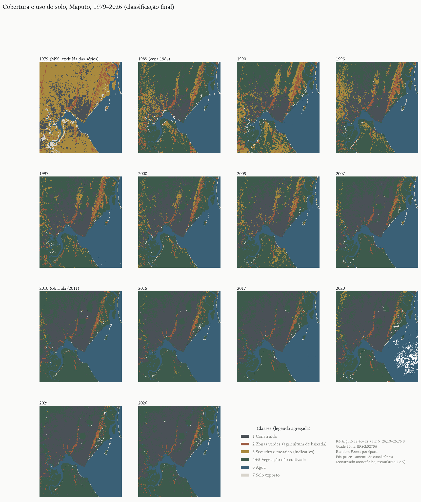
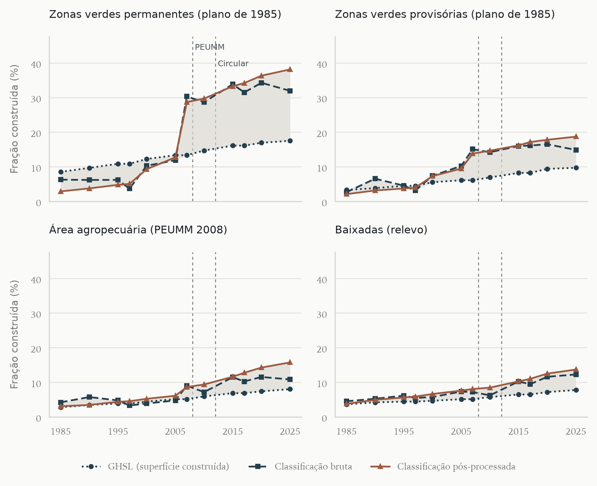
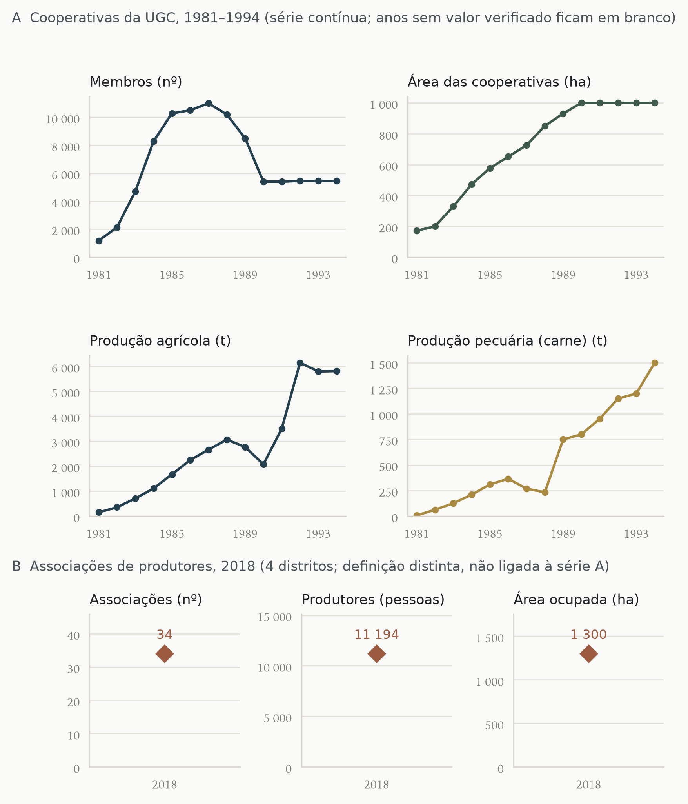
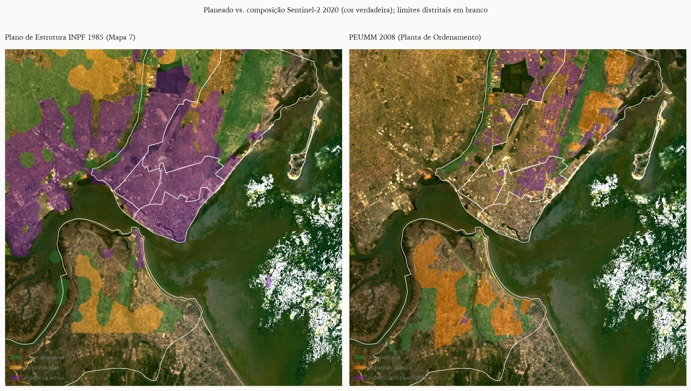

# Resumo

As zonas verdes de Maputo, cintura de hortas e machambas nos vales do Infulene e de Mahotas e na planície costeira de KaMavota, foram reconhecidas desde 1979 como base do abastecimento da cidade e citadas como exemplo de agricultura urbana protegida em África. Este artigo reconstitui a sua trajetória entre 1979 e 2026, combinando a história institucional e dos planos urbanísticos de Lourenço Marques e Maputo com um painel de imagens Landsat nos anos censitários e intercensitários, classificado por Random Forest e avaliado, para 2020, por amostra estratificada interpretada às cegas. Como a agricultura de baixada se separa mal da vegetação não cultivada a 30 m, a medida central é a fração construída dentro de perímetros independentes da classificação. Entre 1985 e 2025, a área construída da cidade cresceu de 37% a 100%, conforme a estimativa; em 2025 estavam construídos entre 17,5% e 38,1% das zonas verdes permanentes do plano de 1985 e entre 8,0% e 15,7% da área agropecuária do plano de 2008, e a fração construída média das baixadas foi de 4,2–5,3% em 1985–1997 para 7,1–12,4% em 2017–2025, com ocupação contínua depois da aprovação do plano de 2008. As séries de produtores indicam contração de dezenas de milhares nos anos 1980 para cerca de onze mil associados em 2018. A comparação com outras cidades mostra que o reconhecimento político da agricultura urbana em Maputo nunca se converteu em estatuto jurídico do solo. Argumenta-se que a cintura agrícola deve ser tratada como infraestrutura verde, pelo seu papel na renda, no abastecimento de folhosas e na drenagem das terras inundáveis.

**Palavras-chave:** agricultura urbana; zonas verdes; Maputo; uso do solo; sensoriamento remoto; planejamento urbano; segurança alimentar.

# Abstract

Maputo's green zones, a belt of vegetable gardens and smallholdings in the Infulene and Mahotas valleys and on the KaMavota coastal plain, have been recognised since 1979 as a basis for the city's food supply and are often cited as a protected urban agriculture system in Africa. This article reconstructs their trajectory from 1979 to 2026 by combining institutional and planning history, from colonial Lourenço Marques to present-day Maputo, with a Landsat image panel for census and intercensal years, classified with Random Forest and assessed, for 2020, with a blind stratified sample. Because lowland agriculture is poorly separated from uncultivated vegetation at 30 m, the main indicator is the built-up share within perimeters defined independently of the agricultural classification. Between 1985 and 2025 the city's built-up area grew by 37% to 100%, depending on the estimate; by 2025, between 17.5% and 38.1% of the permanent green zones of the 1985 structure plan and between 8.0% and 15.7% of the agricultural zone of the 2008 plan were built up, and the mean built-up share of the lowlands rose by a factor of 1.7 to 2.5 between 1985–1997 and 2017–2025, with continued building after the 2008 plan was approved. Producer series point to a contraction from tens of thousands in the 1980s to about eleven thousand association members in 2018. Comparison with other cities shows that the political recognition of urban agriculture in Maputo never became a legal land-use status. We argue that the agricultural belt should be planned as green infrastructure, given its role in livelihoods, leafy-vegetable supply and the drainage of flood-prone land.

**Keywords:** urban agriculture; green zones; Maputo; land use change; remote sensing; urban planning; food security.

# 1 Introdução

As chamadas zonas verdes de Maputo são uma faixa de hortas, machambas e pequenas criações que acompanha os vales do Infulene e de Mahotas e as baixadas costeiras de KaMavota. Desde a independência de Moçambique elas foram tratadas ao mesmo tempo como base do abastecimento da capital, como reserva de terra para a expansão urbana e como estrutura ecológica de drenagem. Essa ambiguidade atravessa os planos urbanísticos, as políticas agrárias e o mercado de terras, e é o objeto deste artigo.

O caso tem peso próprio na literatura sobre agricultura urbana em África. A FAO apresentou Maputo como exemplo de cidade em que as zonas hortícolas foram protegidas e inscritas no ordenamento, com cerca de 13 000 horticultores em 2 300 ha nos vales do Infulene e de Mahotas (FAO, 2012, p. 72). Estudos mais recentes descrevem outro quadro: associações que perdem membros e terra, conversão de canteiros em loteamentos e condomínios na Costa do Sol, salinização das baixadas costeiras e um município que interditou pedidos de "mudança de actividade" depois de sucessivos conflitos (ENGEL; FIEGE; KÜHN, 2019, p. 48, 73; DÜRRNAGEL; SIUEIA JÚNIOR; DÜRRNAGEL, 2022, p. 98, 109, 113). A distância entre as duas leituras é, em parte, um problema de medida: as áreas atribuídas às zonas verdes variam, conforme a fonte e a definição, de 171 ha de cooperativas em 1981 a "mais de 47 000 ha" de produção familiar e cooperativa em 1986 (CHRISTIE, 1996, p. 61; ENGEL; FIEGE; KÜHN, 2019, p. 71).

Este artigo tem três objetivos. O primeiro é reconstituir a trajetória das zonas verdes de Maputo de 1979 a 2026, combinando a história institucional e urbanística com um painel de imagens orbitais nos anos censitários de Moçambique (1980, 1997, 2007 e 2017) e nos anos intercensitários quinquenais. O segundo é medir a conversão de áreas agrícolas em área construída, localizar as frentes de conversão e confrontá-las com os conflitos documentados e com o zoneamento dos planos. O terceiro é situar o caso no debate sobre o papel da agricultura urbana na redução da pobreza, na segurança alimentar e na prestação de serviços ambientais, comparando-o com experiências selecionadas em outras cidades africanas e em outros continentes.

A contribuição é dupla. Empiricamente, o artigo produz uma série espacialmente explícita e de definição constante para um objeto cujas estatísticas são fragmentárias e incompatíveis entre si. Analiticamente, mostra como o estatuto jurídico ambíguo das zonas verdes, protegidas nos textos e disponíveis na prática, organiza a sua erosão. A seção 2 apresenta o referencial teórico; a 3, a trajetória histórica; a 4, os planos urbanísticos de Lourenço Marques e Maputo; a 5, materiais e métodos; a 6, os resultados; a 7 discute o caso à luz da comparação; e a 8 conclui.

# 2 Agricultura urbana em cidades africanas: um debate em três tempos

## 2.1 Definição e genealogia

A agricultura urbana e periurbana é definida menos pela localização do que pela integração no sistema econômico e ecológico da cidade: usa recursos urbanos (terra, água residual, mão de obra, resíduos), abastece mercados urbanos e sofre as pressões próprias da cidade, como a competição pelo solo (MOUGEOT, 2000). Essa definição, consolidada nos anos 1990 em torno do IDRC e da rede RUAF, nasceu de uma agenda de reabilitação: contra a visão de que o cultivo na cidade seria um resquício rural destinado a desaparecer com a modernização, os estudos fundadores sustentaram que se tratava de estratégia de sobrevivência e de atividade comercial em expansão (EGZIABHER et al., 1994; PRAIN; KARANJA; LEE-SMITH, 2010). Parte dessa literatura associou o crescimento da prática às crises urbanas e ao ajuste estrutural (BRYLD, 2003), e mostrou que o cultivo urbano era antigo e ignorado pelas políticas (RAKODI, 1988).

## 2.2 Pobreza e segurança alimentar: da promessa ao ceticismo

A promessa de que a agricultura urbana reduziria a pobreza e a fome urbanas foi posta à prova na década de 2010. Com inquéritos padronizados em onze cidades da África Austral, a rede AFSUN concluiu que a produção urbana de alimentos não era particularmente significativa para a maioria dos agregados, que dependiam sobretudo de supermercados e do comércio informal (CRUSH; HOVORKA; TEVERA, 2011); análises posteriores do mesmo conjunto não encontraram efeito protetor consistente da agricultura urbana sobre a insegurança alimentar dos mais pobres e sugeriram que ela beneficiava quem já tinha renda ou terra (FRAYNE; MCCORDIC; SHILOMBOLENI, 2014). Em quinze países, a participação da agricultura urbana na renda dos agregados mostrou-se limitada, embora associada positivamente à diversidade da dieta (ZEZZA; TASCIOTTI, 2010). Uma revisão sistemática de 35 estudos encontrou contributos substanciais apenas em alguns contextos, com a subsistência como motivação principal e retornos baixos (POULSEN et al., 2015); outra classificou a evidência quantitativa como de baixa qualidade e com resultados mistos (WARREN; HAWKESWORTH; KNAI, 2015). Na síntese organizada por Battersby e Watson, Crush e Riley observam que a promoção da agricultura urbana foi a principal intervenção municipal de segurança alimentar na África do Sul, sem evidência de que tenha alcançado os mais vulneráveis (CRUSH; RILEY, 2019, p. 49), e Battersby e Haysom lembram que quem cultiva, em geral, não são os mais pobres (BATTERSBY; HAYSOM, 2019, p. 58).

Esse ceticismo deslocou a pergunta: em cidades africanas, a insegurança alimentar é sobretudo um problema de acesso, e não de disponibilidade, e a agricultura urbana precisa ser lida no interior de sistemas alimentares em que o retalho informal e a governança local pesam mais do que a produção (BATTERSBY, 2011; BATTERSBY; HAYSOM, 2019). Três matizes, contudo, impedem que a conclusão cética seja generalizada. Primeiro, a participação varia muito entre cidades e bairros (PRAIN; KARANJA; LEE-SMITH, 2010). Segundo, a agricultura urbana tende a dominar nichos de produtos perecíveis: em Dar es Salaam, 70% do amaranto consumido em 2021–2022 era produzido na própria região urbana, contra cerca de 90% das folhosas estimados nos anos 1990, queda que os autores atribuem à perda de terra agrícola (WESSELS; HEMERIJCKX, 2024, p. 3). Terceiro, a medida de sucesso importa: o efeito sobre a segurança alimentar de cada agregado é distinto do contributo da cintura agrícola para o abastecimento da cidade e para o emprego dos produtores. Em Maputo, o inquérito da AFSUN de 2008, centrado nos bairros pobres, encontrou 22% de agregados que produziam algum alimento próprio e apenas 15% que o tinham consumido na semana anterior, e os autores advertiram que o papel da agricultura urbana nessas comunidades é facilmente exagerado (RAIMUNDO; CRUSH; PENDLETON, 2014, p. 17–18). O inquérito de 2014, de abrangência municipal, encontrou cerca de um em cada cinco agregados envolvidos em alguma forma de agricultura urbana, sem gradiente claro por quintil de renda (RAIMUNDO; MCCORDIC; CHIKANDA, 2018, p. 36–37); já entre os produtores das associações, a agricultura é a principal fonte de renda de mais de dois terços dos agregados, ainda que insuficiente para adquirir a cesta básica (ENGEL; FIEGE; KÜHN, 2019, p. xi, 64).

## 2.3 Serviços ambientais e riscos

A literatura recente reenquadrou a agricultura urbana como componente da adaptação climática: hortas de baixada e várzeas cultivadas retêm água de cheia, reduzem o escoamento superficial e mitigam ilhas de calor, ainda que as medições diretas em cidades africanas sejam escassas (LWASA et al., 2014; LWASA et al., 2015). Em Kano, o cultivo de baixios funcionava como zona tampão de inundações, e os agricultores temiam a venda dessas terras para construção (LYNCH; BINNS; OLOFIN, 2001). Os riscos são igualmente documentados: irrigação com águas residuais não tratadas, contaminação por metais e patógenos e uso intensivo de pesticidas (PRAIN; KARANJA; LEE-SMITH, 2010; QADIR et al., 2010; ANTWI-AGYEI et al., 2016). A orientação dominante é gerir o risco por barreiras múltiplas, e não proibir a prática (MOUGEOT, 2000; QADIR et al., 2010). Em Maputo, os dois lados da questão concentram-se no vale do Infulene, que recebe o efluente da estação de tratamento de águas residuais e serve de bacia de drenagem da cidade (REYES TEJADA; KOOY; ZWARTEVEEN, 2024, p. 187, 194).

## 2.4 Terra, posse e planejamento

O ponto de maior consenso é que a insegurança fundiária é a principal ameaça à agricultura urbana (LYNCH; BINNS; OLOFIN, 2001; DAVIES et al., 2021; FAO, 2012). Os governos africanos oscilaram entre atitudes proibitivas e acomodatícias, e a visão modernista do planejamento tendeu a excluir a agricultura do desenho da cidade (MBIBA, 1994; SMIT, 2019, p. 96). O caso de Maputo interessa justamente porque o socialismo pós-independência inverteu essa exclusão, inscrevendo a agricultura no projeto urbano, e porque a sua trajetória posterior permite observar o que acontece com essa inscrição quando o solo urbano passa a ter valor de troca. A pergunta deixa de ser se a agricultura urbana "contribui" para a segurança alimentar e passa a ser em que condições institucionais e fundiárias ela persiste.

# 3 Trajetória histórica das zonas verdes

## 3.1 Lourenço Marques e as suas margens (1876–1975)

Lourenço Marques cresceu sobre um planalto arenoso cercado de terras baixas alagáveis. Os primeiros planos lidaram com essas terras como problema sanitário: o plano de Hall, de 1876, previa o esgoto e o aterro do pântano, e o Projecto de Ampliação de António José de Araújo (1887, aprovado em 1888) traçou a malha ortogonal da cidade alta, drenou o pântano e protegeu de construção a encosta da Malanga (PIMENTEL, 2013, p. 52–55; MENDONÇA, 2018). Ao longo do período colonial, a cidade de cimento e a cidade de caniço separaram-se, e as baixadas cultivadas pertenciam às margens: quintas de colonos e machambas africanas nos vales do Infulene e de Mahotas, fora do perímetro planejado. O Plano Geral de Urbanização de João António de Aguiar, aprovado em 1955, introduziu uma "zona de reserva" e uma "zona rural de protecção" de pelo menos 5 km em torno da cidade; é a primeira cintura formal, mas a sua função era conter e reservar o crescimento urbano, não proteger a agricultura (PIMENTEL, 2013, p. 59–60; UCCLA, 2020). O Plano Director de Mário de Azevedo (1969, aprovado em 1972) passou à escala regional, fez um inquérito ao caniço e zonou a área por vocação biofísica, prevendo a expansão para Mahotas e Machava e um parque linear de drenagem que não chegou a ser construído (PIMENTEL, 2013, p. 61; RAPOSO; JORGE, 2018).

## 3.2 Socialismo e autoabastecimento (1975–1986)

Com a independência e a saída de até 200 000 colonos, quintas e machambas abandonadas foram ocupadas por famílias e grupos organizados (REYES TEJADA; KOOY; ZWARTEVEEN, 2024, p. 191; CHRISTIE, 1996). Em 1979, a primeira Reunião Nacional das Cidades e Bairros Comunais ampliou os limites das cidades para incluir as zonas suburbanas e as zonas verdes, definidas como base do autoabastecimento urbano (RAPOSO; JORGE, 2018, p. 15; CHRISTIE, 1996, p. 40). Em maio de 1980 foi criado o Gabinete das Zonas Verdes, ligado à Presidência e transferido em 1982 para o Ministério da Agricultura (CHRISTIE, 1996, p. 42, 48). A resolução que o criou nunca foi publicada no Boletim da República, de modo que o gabinete operou sem base legal formal (CHRISTIE, 1996, p. 42); a data registrada em outra fonte é abril de 1980 (MOZAMBIQUE HISTORY NET, [s.d.]).

As cooperativas foram o eixo da política. Filiadas à União Geral das Cooperativas, criada em 1982–1983, passaram de 7 cooperativas e 500 membros em 1980 para 210 e 11 000 membros em 1987, com área própria de 725 ha e produção agrícola de 2 662 t naquele ano (CHRISTIE, 1996, p. 58, 61). O crescimento mais rápido coincidiu com a seca e a guerra de 1981–1984 (CHRISTIE, 1996, p. 61). As cooperativas eram, contudo, apenas uma parte do sistema: em 1988, o Gabinete estimava cerca de 60 000 agricultores familiares, 400 privados e 11 000 cooperados, num total de 71 400 produtores em 15 300 ha (CHRISTIE, 1996, p. 52–53). A cooperação italiana financiou, entre 1985 e 1993, a drenagem e a irrigação do Infulene, com 13 km de canais principais e 130 km de secundários (CHRISTIE, 1996, p. 57). O lado coercitivo do período também marcou as margens da cidade: a Operação Produção, de 1983, deslocou à força para o norte do país moradores considerados improdutivos (REYES TEJADA; KOOY; ZWARTEVEEN, 2024, p. 191).

## 3.3 Ajuste, liberalização e associações (1987–1999)

A liberalização dos preços de hortícolas em 1985 e o Programa de Reabilitação Econômica de 1987 retiraram o apoio estatal e alteraram a economia das zonas verdes (CHRISTIE, 1996, p. 15, 19). Os membros das cooperativas caíram de 11 000 em 1987 para 5 450 em 1992–1994; em 1991, a assembleia da União autorizou o parcelamento individual e 145 cooperativas optaram por repartir a terra (CHRISTIE, 1996, p. 61, 67). A União reorientou-se para a avicultura, com uma fábrica de ração e uma incubadora de 80 000 pintos por semana a partir de 1989 (CHRISTIE, 1996, p. 67). As associações de produtores tornaram-se a forma organizativa dominante, e a produção do setor privado e familiar ganhou peso (CHRISTIE, 1996, p. 53–54; ENGEL; FIEGE; KÜHN, 2019, p. 71).

Esse é também o período em que se forma um mercado de terras nas zonas verdes. Num levantamento de 1991, Roth, Boucher e Francisco registraram que, das 34 parcelas alienadas pelos agregados da amostra, 65% o foram por despejo, em favor de agricultores privados, do Estado ou de associações, e menos de 12% dos despejados receberam compensação (ROTH; BOUCHER; FRANCISCO, 1995, p. xviii). Em 1995, 96,8% dos agricultores de cinco distritos não tinham título de uso da terra (CHRISTIE, 1996, p. 54). A Lei de Terras de 1997 confirmou a propriedade estatal do solo e o direito de uso e aproveitamento da terra (DUAT), mas foi vaga quanto à terra urbana, e a literatura associa-a à consolidação de um mercado ilegal de terrenos (REYES TEJADA; KOOY; ZWARTEVEEN, 2024, p. 193–195).

## 3.4 Mercado de terras, infraestrutura e pressão imobiliária (2000–2026)

Três tipos de evento marcam o período recente. O primeiro são as cheias: a de 2000, a pior em mais de meio século no sul do país, sobrecarregou a drenagem do Infulene e levou ao abandono de parcelas; as obras de elevação da Avenida Joaquim Chissano agravaram as inundações e a salinidade a jusante (REYES TEJADA; KOOY; ZWARTEVEEN, 2024, p. 194, 196). O segundo são as infraestruturas: a Estrada Circular de Maputo, cujas obras começaram em 2012, tornou acessível à urbanização a planície costeira de KaMavota e elevou os valores da terra (DÜRRNAGEL; SIUEIA JÚNIOR; DÜRRNAGEL, 2022, p. 98); a ponte Maputo–KaTembe, inaugurada em novembro de 2018 (PR MOÇAMBIQUE INAUGUROU PONTE QUE LIGA AS DUAS MARGENS DA BAÍA DE MAPUTO, 2018), abriu a margem sul; a reabilitação da estação de tratamento do Infulene previu o reassentamento de cerca de 100 agricultores em Marracuene (REYES TEJADA; KOOY; ZWARTEVEEN, 2024, p. 196–197). O terceiro é a pressão imobiliária direta: os pesquisadores do projeto UFISAMO viram terra arável da Costa do Sol convertida em canteiros de obras de centros comerciais, hotéis e habitação de alta renda (ENGEL; FIEGE; KÜHN, 2019, p. 48); em KaMavota, a maioria das associações já cedera parte das suas áreas em 2021, e houve um caso de associação "falsa" criada com a identidade de membros para construir condomínios (DÜRRNAGEL; SIUEIA JÚNIOR; DÜRRNAGEL, 2022, p. 108–109).

Em 2018 restavam 34 associações com 11 194 produtores em cerca de 1 300 ha, concentradas em KaMavota (816 ha) e KaMubukwana (422 ha); os seus presidentes relatavam perda de membros por envelhecimento, mudança de atividade e venda de espaço para construção (ENGEL; FIEGE; KÜHN, 2019, p. 73). Cerca de 70% dos produtores são mulheres e 42% têm mais de 65 anos (ENGEL; FIEGE; KÜHN, 2019, p. 38, 64). A salinização das baixadas costeiras, associada à subida do nível do mar, é outro fator de abandono (ENGEL; FIEGE; KÜHN, 2019, p. 52; DÜRRNAGEL; SIUEIA JÚNIOR; DÜRRNAGEL, 2022, p. 98, 112–113).

# 4 Os planos urbanísticos e as zonas verdes

## 4.1 Da cintura de proteção à zona agropecuária

A leitura dos planos mostra uma linha contínua de reserva de uma faixa periurbana, cuja função muda de plano para plano (Quadro 1). Os planos coloniais trataram a periferia como reserva de expansão e zona de proteção sanitária e paisagística; só depois da independência ela passou a ser pensada como espaço agrícola.

Quadro 1 – Planos urbanísticos e decisões políticas relativos à periferia agrícola, Lourenço Marques e Maputo, 1876–2026

| Ano | Plano | Autor/órgão | Estatuto | Tratamento da agricultura |
|---|---|---|---|---|
| 1876 | Plano de esgoto e aterro do pântano de Lourenço Marques | R. T. Hall, a pedido do governador A. de Castilho | Não executado como cidade nova; drenagem do pântano realizada | Sem tratamento de agricultura nas fontes lidas |
| 1878 | Planta da nova povoação / Projecto de melhoramentos | F. Jeppe; J. A. Ferreira Maia (autoria divergente entre fontes) | Não realizados | Sem tratamento de agricultura |
| 1887 | Projecto de Ampliação da Cidade de Lourenço Marques (Plano Araújo) | A. J. de Araújo, diretor de Obras Públicas | Aprovado; execução parcial | Sem agricultura nem cintura; reserva espaços para jardins e protege de construção a encosta da Malanga |
| 1940 | Eixo cívico / plano de urbanização | L. Cristino da Silva | Parcialmente executado | Sem tratamento de agricultura |
| 1955 | Plano Geral de Urbanização de Lourenço Marques (Plano Aguiar) | J. A. Aguiar; Gabinete de Urbanização do Ultramar | Aprovado | Zona de reserva junto à cidade e “zona rural de protecção” de pelo menos 5 km: primeira cintura formal, de função urbana e não agrícola |
| 1962–67 | Estudos de urbanização e revisão do PGULM | V. Camelo; F. Mesquita (serviços da Câmara Municipal) | Estudos; sem aprovação referida | Sem tratamento de agricultura |
| anos 1960 | Plano Regulador da Ocupação do Solo nos Arredores de Lourenço Marques (PROSALM) | Comissão criada para o plano | n.d. | Conteúdo não descrito nas fontes lidas |
| 1969 | Plano Director de Urbanização de Lourenço Marques | M. de Azevedo; Gabinete de Urbanização da Câmara Municipal | Aprovado em 1972; seguido na gestão depois de 1975 | Sem agricultura no texto de Pimentel; “áreas verdes” como património natural e corredor de drenagem; zonamento pela vocação biofísica |
| 1960–70 | Plano de Beneficiação da Área Suburbana; Plano Parcial das Lagoas | GUHARLM | Poucas ações concretizadas | Sem tratamento de agricultura nas fontes lidas |
| 1979 | 1.ª Reunião Nacional das Cidades e Bairros Comunais | Governo/Frelimo | Decisão política, não plano | Zonas verdes incorporadas ao território urbano como base do autoabastecimento urbano |
| 1985 | Plano de Estrutura da Cidade de Maputo | Instituto Nacional de Planeamento Físico (INPF) | Não aprovado; o plano de 1969 continuou a vigorar | Zona agropecuária de pequenas quintas no Infulene e na Costa do Sol; legenda com zonas verdes permanentes e provisórias |
| 1999 | Plano de Estrutura da Área Metropolitana de Maputo (PEAMM) | Arcadis Euroconsult; IHS; JTK Associates (Banco Mundial) | Não entrou em vigor | Sem agricultura no texto lido |
| 2008 | Plano de Estrutura Urbana do Município de Maputo (PEUMM) | Conselho Municipal de Maputo; UEM | Em vigor; revisão devida após 10 anos | Classe “Espaço para Actividade Agrícola”, com exceções amplas (edifícios, aterros) e, no art. 74(e), unidades hoteleiras em lotes de 10 000 m² ou mais |
| 2010 | Planos Parciais de Urbanização de Zimpeto, Magoanine B e C e Maxaquene A | Conselho Municipal de Maputo | Aprovados | Conteúdo agrícola não descrito |
| 2010 | Plano de Estrutura Urbana da Cidade da Matola | Município da Matola | Aprovado (segundo JICA; não verificado em ato) | Não verificado |
| 2012 | Plano Geral de Urbanização de KaTembe | Betar | Revisão financiada pelo PTUM | Sem classe agrícola; IDA (2024) prevê “50km2 of protected area and public equipment” |
| 2014 | Plano Parcial de Urbanização do Bairro Luís Cabral | Conselho Municipal de Maputo | Em vigor | Espaços agrícolas de produção e a recuperar; permite e incentiva agricultura e silvicultura; prevê demolir construções de outro uso |
| 2014 | Plano Diretor de Transportes da Grande Maputo | JICA; PADECO; Nippon Koei; Conselho Municipal de Maputo | Estudo técnico | “Greenbelt” como bacia de retenção; variante da EN1 ao longo dela afeta terra agrícola; Marracuene e Boane tratados como áreas de crescimento |
| 2021 | PTUM (P171449), componente 3(c)(i): plano espacial urbano | Conselho Municipal de Maputo; Banco Mundial (IDA) | Em execução | Agricultura não mencionada no acordo |
| 2026 | Revisão do PEUMM / novo modelo territorial | Conselho Municipal de Maputo | Consultoria lançada; sem prazo nem consultor divulgados | Agricultura e zonas verdes não mencionadas na notícia |

Fonte: elaboração própria a partir de (PIMENTEL, 2013; MENDONÇA, 2018; RAPOSO; JORGE, 2018; CHRISTIE, 1996; CMM, 2021a; CMM, 2021b; JICA, 2014; IDA, 2024).

O Plano de Estrutura da Cidade de Maputo, preparado em 1985 pelo Instituto Nacional de Planeamento Físico, é o primeiro a mapear zonas verdes agrícolas (Figura 1). Propunha uma zona agropecuária de pequenas quintas ao longo do Infulene e junto à Costa do Sol, para abastecer a cidade e ocupar deslocados de guerra, e a sua legenda distinguia "zonas verdes permanentes" e "zonas verdes provisórias" (PIMENTEL, 2013, p. 64). Segundo o levantamento citado por Christie, eram 5 230 ha permanentes, dos quais apenas 1 190 ha demarcados, e 2 575 ha provisórios, nos quais o produtor deveria sair sem compensação quando começasse o projeto urbano (CHRISTIE, 1996, p. 46). O plano nunca foi aprovado formalmente, e o de 1969 continuou a ser a referência da gestão urbana (PIMENTEL, 2013, p. 64). A classe das zonas provisórias institucionalizou desde a origem a ideia de que parte da cintura agrícola era, na verdade, solo urbano em espera.

O Plano de Estrutura da Área Metropolitana de Maputo (1999), elaborado por consultores com financiamento do Banco Mundial, também nunca entrou em vigor, e os textos consultados não tratam da agricultura (PIMENTEL, 2013, p. 65–66).

## 4.2 O PEUMM de 2008: protegidas no texto, disponíveis na prática

O Plano de Estrutura Urbana do Município de Maputo (PEUMM), de 2008, é o instrumento em vigor. O seu regulamento cria a classe "Espaço para Actividade Agrícola", representada na planta de ordenamento como "Área de Agro-Pecuária" (Figura 2). O artigo 11 declara esses solos "exclusivamente dedicados à agricultura" e justifica a sua proteção pela produção alimentar e pelo equilíbrio ecológico, mas, no mesmo artigo, admite edifícios, aterros e escavações ao serviço da atividade; o artigo 74 lista os usos que podem ser autorizados, incluindo, na alínea (e), unidades hoteleiras, em lotes de pelo menos 10 000 m² (PIMENTEL, 2013, Anexo III, p. 9, 31–32). O próprio diagnóstico do plano reconhece que, "por ausência de regulamentação específica", construções, aterros e escavações destruíam terras agrícolas (PIMENTEL, 2013, Anexo III, Vol. I, p. 185). As baixadas cultivadas sobrepõem-se ainda à estrutura ecológica municipal (áreas húmidas e inundáveis), cujo regime o plano remete para a lei geral (PIMENTEL, 2013, Anexo III, p. 9, 32–33).

O extrato do plano consultado não traz a área da classe agrícola (o quadro de áreas está em branco). A vetorização da planta de ordenamento georreferenciada neste estudo dá 3.370 ha na parte continental da cidade. Para comparação, Jenkins estimava que a terra em agricultura urbana ocupava 26% da área urbana em 2013, segundo Reyes Tejada e coautores (REYES TEJADA; KOOY; ZWARTEVEEN, 2024, p. 196). A planta de ordenamento coloca a classe agropecuária ao lado de "áreas para expansão urbana" e de "áreas urbanizáveis não planificadas", sem regra de prevalência explícita entre elas. Um plano parcial posterior, o do bairro Luís Cabral, na margem do Infulene, é mais preciso: classifica espaços agrícolas de produção e espaços a recuperar para a agricultura (CMM, 2021a, p. 61–62).

## 4.3 O quadro nacional e a revisão em curso

O quadro nacional avançou mais do que o municipal. A Política de Urbanização de 2024 identifica a "rápida conversão de terra agrícola em solo urbano intensivo" como problema e estabelece como ação estratégica integrar a agricultura urbana nos instrumentos de ordenamento do território, mapeando as áreas propícias (MOÇAMBIQUE, 2024, p. 2784, 2817). O Regulamento do Solo Urbano, de 2006, impede a aquisição de novos DUAT em zonas de proteção parcial, como as margens de cursos de água, ressalvados os direitos adquiridos (MOÇAMBIQUE, 2006). Em sentido contrário, os instrumentos de infraestrutura tratam a cintura agrícola como reserva: o plano de transportes da Grande Maputo, de 2014, usa a "Greenbelt" como bacia de retenção e prevê uma variante da EN1 ao longo dela, admitindo que "alguma terra agrícola" seria afetada, e indica Marracuene e Boane, hoje agrícolas, como áreas de crescimento (JICA, 2014, p. 28, 45). O financiamento do Banco Mundial ao Projecto de Transformação Urbana de Maputo inclui um plano espacial urbano, bacias de detenção e a revisão do plano de KaTembe, sem menção à agricultura (IDA, 2024, p. 5, 7). Em setembro de 2026, o Conselho Municipal anunciou a revisão do PEUMM; a comunicação pública fala em densificação, expansão, mobilidade e proteção ambiental, mas não em agricultura (CLUB OF MOZAMBIQUE, 2026).

# 5 Materiais e métodos

## 5.1 Área de estudo e unidades de análise

A análise cobre um retângulo de 35 × 39 km (32,40–32,75° E; 25,75–26,10° S) que contém a parte continental da Cidade de Maputo, a margem da Matola no vale do Infulene e o sul de Marracuene, numa grade de 30 m em projeção UTM 36S. As unidades de agregação são os sete distritos municipais e os 64 bairros da base administrativa oficial de 2025 (OCHA, 2026). O distrito de KaNyaka (ilha de Inhaca) fica fora da área.

## 5.2 Épocas e imagens

As épocas seguem os anos dos recenseamentos gerais de Moçambique (1980, 1997, 2007, 2017) e os anos intercensitários quinquenais: 1980, 1985, 1990, 1995, 1997, 2000, 2005, 2007, 2010, 2015, 2017, 2020, 2025 e 2026. A fonte principal são as composições geomedianas anuais do Digital Earth Africa, que combinam todas as observações Landsat livres de nuvem de cada ano e trazem medidas de variabilidade intra-anual (DIGITAL EARTH AFRICA, 2026). Essas medidas são úteis aqui, porque as hortas de baixada, com ciclos curtos e sucessivos, variam muito ao longo do ano, ao contrário de telhados, matas ou capinzais.

Três épocas exigiram substituição (Quadro 2). Não há imagem Landsat utilizável de 1980 para a área; a época censitária é representada por uma cena Landsat 3 MSS de 9 de junho de 1979, de 60 m e quatro bandas. A composição de 1985 cobria apenas 30% da área e foi substituída pela cena Landsat 5 TM de 1.º de junho de 1984. A composição de 2010 apresentava faixas de falha do sensor Landsat 7 e foi substituída pela cena Landsat 5 de 9 de abril de 2011, fora da estação seca. Para 2026 ainda não existe composição anual, e usou-se a mediana de 12 cenas Landsat 8 e 9 de maio a agosto de 2026 (EARTH RESOURCES OBSERVATION AND SCIENCE (EROS) CENTER, 2020).

Quadro 2 – Imagens, sensores e substituições por época do painel Landsat

| Época | Fonte/imagem | Sensor | Observação | Exatidão OOB |
|---|---|---|---|---|
| 1980 | Cena LM03 de 9 jun. 1979 (substitui o censo de 1980) | Landsat 3 MSS, 60 m | Reamostrada a 30 m; sem bandas azul e SWIR; mapa tratado como ordem de grandeza | 0,91 |
| 1985 | Cena LT05 de 1.º jun. 1984 | Landsat 5 TM | Substitui o GeoMAD de 1985, que cobria apenas 30% da área | 0,90 |
| 1990 | GeoMAD anual, Digital Earth Africa (gm_ls5_ls7_annual) | Landsat 5/7 TM/ETM+ | — | 0,94 |
| 1995 | GeoMAD anual, Digital Earth Africa (gm_ls5_ls7_annual) | Landsat 5/7 TM/ETM+ | — | 0,90 |
| 1997 | GeoMAD anual, Digital Earth Africa (gm_ls5_ls7_annual) | Landsat 5/7 TM/ETM+ | — | 0,92 |
| 2000 | GeoMAD anual, Digital Earth Africa (gm_ls5_ls7_annual) | Landsat 5/7 TM/ETM+ | — | 0,91 |
| 2005 | GeoMAD anual, Digital Earth Africa (gm_ls5_ls7_annual) | Landsat 5/7 TM/ETM+ | — | 0,92 |
| 2007 | GeoMAD anual, Digital Earth Africa (gm_ls5_ls7_annual) | Landsat 5/7 TM/ETM+ | — | 0,96 |
| 2010 | Cena LT05 de 9 abr. 2011 | Landsat 5 TM | Substitui o GeoMAD de 2010, com faixas de falha do Landsat 7; fora da estação seca | 0,96 |
| 2015 | GeoMAD anual, Digital Earth Africa (gm_ls8_annual) | Landsat 8 OLI | — | 0,97 |
| 2017 | GeoMAD anual, Digital Earth Africa (gm_ls8_annual) | Landsat 8 OLI | — | 0,98 |
| 2020 | GeoMAD anual, Digital Earth Africa (gm_ls8_annual) | Landsat 8 OLI | — | 0,97 |
| 2025 | GeoMAD anual, Digital Earth Africa (gm_ls8_ls9_annual) | Landsat 8/9 OLI | — | 0,98 |
| 2026 | Mediana de 12 cenas LC08/LC09, mai.–ago. 2026 | Landsat 8/9 OLI | Sem composição anual disponível | 0,97 |

Fonte: elaboração própria. A coluna de exatidão é a out-of-bag dos modelos (reprodução dos rótulos de treino, não validação independente).

## 5.3 Legenda e classificação

A legenda tem sete classes: (1) construído; (2) agricultura de baixada, que corresponde às zonas verdes no sentido estrito, isto é, hortas irrigadas e machambas em solos hidromórficos de vales e baixadas costeiras (*machongo*); (3) agricultura de sequeiro e mosaico, com machambas de milho e mandioca em interflúvios arenosos e pousios curtos; (4) vegetação arbórea e arbustiva, incluindo mangal; (5) herbácea e zonas húmidas não cultivadas; (6) água; (7) solo exposto e areia. Cada época foi classificada por um modelo Random Forest próprio (BREIMAN, 2001), com as bandas de reflectância, os índices NDVI, NDBI, MNDWI e BSI, as medidas de variabilidade da geomediana quando disponíveis e três atributos de relevo do Copernicus DEM (altitude, declive e posição topográfica), que separam as baixadas cultivadas dos interflúvios (EUROPEAN SPACE AGENCY, 2022).

As amostras de treino foram construídas sem digitalização manual. Para a época âncora de 2020 tomaram-se os píxeis em que concordam os mapas globais ESA WorldCover e Impact Observatory/Esri (ZANAGA et al., 2022; KARRA et al., 2021) e, para a classe construída, também a superfície construída do GHSL (PESARESI, 2023), além dos polígonos de uso agrícola do OpenStreetMap. Os píxeis agrícolas foram separados em baixada e sequeiro pela altitude e pela posição topográfica. As amostras de 2020 foram propagadas para as demais épocas apenas quando a assinatura espectral se manteve estável e quando eram coerentes com a série de área construída do GHSL (PESARESI, 2023). Nas épocas até 2005 foram acrescentadas amostras dos mapas de uso do solo de Maputo de 1982, 1991 e 2001, produzidos por fotointerpretação de fotografias aéreas (HENRIQUES; CORREIA; ROLO, 2023). O mapa de 1979, de resolução e bandas mais limitadas, foi tratado como estimativa de ordem de grandeza. Os mapas receberam um filtro modal 3 × 3 e, em seguida, um pós-processamento temporal aplicado ao conjunto das treze épocas de 1985 a 2026, com três regras: (i) um píxel classificado como construído numa época só é mantido como tal se também estiver construído em pelo menos duas das três épocas de uma janela centrada nela (deslocada nas extremidades da série); (ii) a partir da primeira época em que é confirmado, o píxel permanece construído, de modo que a série construída é não decrescente por construção; (iii) alternâncias isoladas entre agricultura de baixada e vegetação herbácea numa época intermediária são substituídas pela classe das épocas vizinhas. O pós-processamento alterou entre 35.311 e 125.771 píxeis por época. Como a regra (ii) acumula os erros de comissão confirmados, os resultados centrais são apresentados também com a classificação bruta, sem pós-processamento, e com o GHSL (seção 5.4). O GHSL não é, contudo, uma referência independente: a sua superfície construída ajudou a definir as amostras de treino da classe construída e a propagá-las entre épocas, de modo que a concordância entre as três estimativas é em parte construída pelo próprio método.

## 5.4 Avaliação

A exatidão foi avaliada em três níveis. O primeiro é interno: erro *out-of-bag* dos modelos e validação cruzada em blocos espaciais de 3 km nas épocas de 2000, 2011 e 2020, que mede a capacidade de reproduzir os rótulos de treino. O segundo é a coerência externa com o GHSL (área construída, 1975–2025), com os mapas globais de terra agrícola e com os mapas fotointerpretados de 1982, 1991 e 2001 (HENRIQUES; CORREIA; ROLO, 2023). O terceiro é uma amostra aleatória estratificada de 280 pontos sobre o mapa de 2020, com a qual se estimaram a exatidão e as áreas ajustadas com intervalos de 95% segundo Olofsson e coautores (OLOFSSON et al., 2014). Os pontos foram rotulados às cegas, sem acesso ao mapa, por interpretação de recortes de composições Sentinel-2 de 10 m e Landsat de 30 m. A interpretação foi feita por um agente automático de análise de imagens, instruído com a legenda e isolado dos dados de classificação; 118 dos 280 rótulos (42%) foram marcados como de baixa confiança. A avaliação refere-se apenas a 2020, e uma revisão humana de uma subamostra está entre os passos pendentes do estudo.

Na área total do estudo, a amostra mostrou que a classe construída é confiável (exatidão do usuário 0,88 e do produtor 0,88), mas que a agricultura de baixada não se separa bem da vegetação não cultivada: a exatidão do usuário da classe 2 foi 0,33 e a do produtor, 0,16. Restrita à cidade, a área ajustada da classe 2 em 2020 é de 1.499 ± 1.675 ha, um intervalo compatível tanto com a área das associações quanto com o dobro dela. Sem os rótulos de baixa confiança (162 pontos), a exatidão do usuário fica em 0,96 para o construído e 0,56 para a classe 2. Parte do problema está na própria referência, já que canteiros de 2 a 4 m² (ENGEL; FIEGE; KÜHN, 2019, p. 48) e machambas médias de 0,3 ha (REYES TEJADA; KOOY; ZWARTEVEEN, 2024, p. 187) não são visíveis mesmo a 10 m, mas o resultado impõe cautela. Por isso a métrica central deste artigo não é a área mapeada de zonas verdes, e sim a **ocupação por construção** — a classe validada — dentro de perímetros definidos de forma independente da classificação agrícola: (i) as baixadas, definidas pelo relevo (altitude inferior a 15 m e posição topográfica côncava), onde se concentram os solos hidromórficos cultivados; (ii) as zonas verdes permanentes e provisórias do Plano de Estrutura de 1985; e (iii) a classe agropecuária do PEUMM de 2008. Para cada perímetro e época, a fração construída é estimada de três formas: pela classificação bruta, pela classificação pós-processada e pela fração de superfície construída do GHSL (PESARESI, 2023). O GHSL mede a área efetivamente coberta por edificações e por isso dá os valores mais baixos; a classificação mede o tecido construído, com quintais e arruamentos. Os resultados são apresentados como o intervalo entre as três estimativas, e as conclusões apoiam-se apenas nas tendências em que as três concordam. Esse intervalo não é um intervalo de confiança, e as três estimativas não são independentes: a bruta e a pós-processada vêm do mesmo modelo, e o GHSL orientou os rótulos de treino. Além disso, o GHSL R2023A só observa as épocas de 1975, 1990, 2000, 2014 e 2018 e interpola as demais por "spatial-temporal interpolation of five observed collections" (EUROPEAN COMMISSION, 2024, p. 6); os seus valores de 2010, 2020 e 2025 não são observações próprias. Por isso as mudanças são resumidas por médias de dois períodos, 1985–1997 e 2017–2025, e não se datam acelerações a partir de épocas isoladas. O ano final dos números é 2025; a composição de 2026, uma mediana de cenas de poucos meses, é usada só no painel visual. A série da classe 2 é apresentada como indicativa.

## 5.5 Métricas e cruzamentos

A partir dos mapas calcularam-se a área por classe, época, distrito e bairro; matrizes de transição entre épocas consecutivas; a taxa anual de conversão de área agrícola em construída; e o ano da primeira conversão de cada píxel. As zonas verdes do Plano de Estrutura de 1985 e a classe agropecuária do PEUMM de 2008 foram georreferenciadas por pontos de controle e vetorizadas, o que permite comparar o zoneamento planejado com o uso observado. Os conflitos documentados na literatura e na imprensa foram compilados; 9 deles puderam ser localizados de forma aproximada no mapa e servem apenas de referência qualitativa. As séries de produtores, área e produção foram compiladas com fonte, página e definição espacial de cada valor, sem interpolação nem soma entre definições distintas.

# 6 Resultados

## 6.1 A expansão urbana, 1985–2025

A área construída da parte continental da cidade cresceu entre 37% e 100% de 1985 a 2025, conforme a estimativa: 37% pela superfície construída do GHSL, 59% pela classificação bruta e 100% pela classificação pós-processada (Figura 3). A amplitude do intervalo vem sobretudo de 1985, representado por uma única cena de junho de 1984, em que o construído é subdetectado; a partir de 1990, com composições anuais, a classificação pós-processada indica um crescimento de 69% até 2025. O crescimento concentrou-se no norte de KaMubukwana (Magoanine, Zimpeto) e, a partir dos anos 2010, na planície costeira de KaMavota e em KaTembe, depois da ponte. Como referência para a época censitária de 1980, os mapas fotointerpretados de 1982, que cobrem 54% da cidade, registram 2.685 ha construídos e 1.982 ha agrícolas nessa área de cobertura (HENRIQUES; CORREIA; ROLO, 2023); outros 3.860 ha de classes ambíguas nessa legenda (residencial de baixa densidade, vias, equipamentos) não foram atribuídos a nenhuma das nossas classes, de modo que o construído de 1982 está subestimado.

## 6.2 A ocupação das zonas agrícolas planejadas e das baixadas

A medida mais robusta do avanço urbano sobre as zonas verdes é a fração construída dentro de perímetros que não dependem da classificação agrícola (Tabela 1 e Figura 4). Em todos os perímetros e nas três estimativas, essa fração pelo menos dobrou entre 1985 e 2025.

Tabela 1 – Fração construída (%) dentro de perímetros agrícolas e de baixada: intervalo entre três estimativas (GHSL, classificação bruta e classificação pós-processada), Cidade de Maputo (parte continental), 1985–2025

| Perímetro | Área (ha) | 1985 | 1990 | 2000 | 2010 | 2020 | 2025 |
|---|---:|---:|---:|---:|---:|---:|---:|
| Zonas verdes permanentes (plano de 1985) | 5.754 | 2,9–8,5 | 3,7–9,7 | 9,3–12,2 | 14,7–29,7 | 16,9–36,3 | 17,5–38,1 |
| Zonas verdes provisórias (plano de 1985) | 1.930 | 2,1–3,3 | 3,1–6,5 | 5,5–7,4 | 6,9–14,6 | 9,4–17,8 | 9,7–18,7 |
| Área agropecuária (PEUMM 2008) | 3.370 | 2,8–4,2 | 3,4–5,7 | 3,9–5,2 | 5,9–9,3 | 7,4–14,2 | 8,0–15,7 |
| Baixadas (relevo) | 6.033 | 3,6–4,5 | 4,2–5,2 | 4,7–6,6 | 5,7–8,4 | 7,2–12,5 | 7,8–13,7 |

Fonte: elaboração própria; GHSL GHS-BUILT-S R2023A (Pesaresi; Politis, 2023). Nota: o GHSL mede a superfície coberta por edificações e tende a dar os valores mais baixos; a classificação mede o tecido construído (com quintais e arruamentos). Área dos perímetros na cidade, sem água permanente.

Nas zonas verdes permanentes do Plano de Estrutura de 1985 (5.754 ha na cidade, segundo a vetorização do mapa georreferenciado), a fração construída em 2025 estava entre 17,5% (GHSL) e 38,1% (classificação pós-processada). Só 32% dessas zonas ficam nas baixadas definidas pelo relevo; o restante está em terrenos mais altos, onde a ocupação foi mais rápida. Na cidade, as zonas provisórias, que o plano destinava à futura expansão urbana, tinham em 2025 uma fração construída menor (entre 9,7% e 18,7%); no conjunto do mapa de 1985, que inclui a Matola, a relação inverte-se (55,0% nas permanentes contra 68,9% nas provisórias, classificação pós-processada). Dada a incerteza da vetorização das duas categorias, que se distinguem no original apenas pela densidade do pontilhado, não se pode afirmar que a expansão tenha seguido ou invertido a hierarquia do plano.

Na classe agropecuária do PEUMM de 2008 (3.370 ha), a fração construída passou de 5,9–9,3% em 2010 para 8,0–15,7% em 2025: nas três estimativas, a ocupação continuou depois da aprovação do plano que deveria protegê-la (no GHSL, entre uma época interpolada e outra extrapolada), num ritmo anual entre 4,7 e 14,3 ha. Nas baixadas definidas pelo relevo (6.033 ha), a fração construída passou de 3,6–4,5% em 1985 para 5,7–8,4% em 2010 e 7,8–13,7% em 2025. Em médias de período, a fração construída das baixadas passou de 4,2–5,3% em 1985–1997 para 7,1–12,4% em 2017–2025, um fator de 1,7 a 2,5 conforme a estimativa; na classe agropecuária do PEUMM, o fator foi de 2,1 a 3,7. A versão anterior deste artigo afirmava que o ritmo de ocupação das baixadas aumentara depois de 2010 nas três estimativas; essa afirmação foi retirada, porque o GHSL interpola a época de 2010 e extrapola as de 2020 e 2025 (EUROPEAN COMMISSION, 2024, p. 6) e porque a época de 2010 da classificação usa uma cena de abril de 2011, fora da estação seca. O aumento entre os dois períodos é coerente com os conflitos documentados na Costa do Sol e em KaMavota (seção 3.4), mas os dados não permitem datar quando a ocupação se intensificou. Nas duas classificações há um salto entre 2005 e 2007 nas zonas permanentes que não aparece no GHSL e que deve resultar da diferença entre as composições dessas duas épocas.

## 6.3 A agricultura de baixada mapeada

A área mapeada de agricultura de baixada na cidade caiu de 2.555 ha em 1990 para 1.289 ha em 2025. Pelos motivos expostos na seção 5.4, essa série é apenas indicativa: o mapa subestima e confunde a classe, e a área ajustada de 2020 na cidade (1.499 ± 1.675 ha) tem um intervalo de confiança cujo limite inferior chega a zero. Por isso ela não permite arbitrar entre as estimativas da literatura, nem localizar a perda por bairro: a maior parte da redução mapeada corresponde a passagens para vegetação não cultivada, que não se distinguem de erro de classificação. Só a parcela convertida em área construída, que usa a classe validada, é interpretável; ela se concentra na planície costeira de KaMavota (Albazine, Costa do Sol) e, fora da cidade, em bairros da Matola e de Marracuene.

## 6.4 Produtores e produção: séries fragmentárias

As séries de produtores e de produção confirmam a trajetória, mas não permitem uma série contínua (Figura 5). O setor cooperativo cresceu de 7 cooperativas e 500 membros em 1980 para 210 cooperativas e 11 000 membros em 1987, e a sua produção agrícola chegou a 6 150 t em 1992, com os membros já reduzidos a metade (CHRISTIE, 1996, p. 58, 61). Em 1988, o conjunto das zonas verdes reunia, segundo o Gabinete, cerca de 71 400 produtores em 15 300 ha, a maioria familiares (CHRISTIE, 1996, p. 52–53). Em 2018, as 34 associações tinham 11 194 produtores em 1 300 ha (ENGEL; FIEGE; KÜHN, 2019, p. 73). Entre 1995 e 2016 não foi encontrada nenhuma série; as metas anuais de produção divulgadas pelo município nos anos 2020 não são medições e não foram usadas. A comparação entre os dois extremos exige cautela, porque as definições mudam (cooperativas, setor familiar, associações), mas a ordem de grandeza da contração é clara: de dezenas de milhares de produtores e milhares de hectares nos anos 1980 para cerca de onze mil associados em pouco mais de mil hectares.

## 6.5 Planejado e ocorrido

O cruzamento dos planos com o uso observado resume os resultados (Figura 6). Das zonas verdes permanentes de 1985, entre 17,5% e 38,1% estavam construídas em 2025; da classe agropecuária de 2008, entre 8,0% e 15,7%. Em nenhum dos dois casos a proteção formal impediu a ocupação; no segundo, ela continuou depois da aprovação do plano. Os 20 episódios de conflito e pressão documentados desde 1983 distribuem-se pelas mesmas áreas: as primeiras disputas pela terra das cooperativas, nos anos 1980; os despejos e vendas nas zonas não demarcadas, nos anos 1990; e, desde 2012, a conversão para habitação e condomínios na planície costeira de KaMavota e o reassentamento ligado à estação de tratamento do Infulene.

# 7 Discussão: Maputo em perspectiva comparada

## 7.1 Uma cintura que encolhe sem desaparecer

Os resultados mostram uma cintura agrícola que encolhe sem desaparecer. A área construída da cidade cresceu entre 37% e 100% de 1985 a 2025, e a ocupação avançou sobre todas as categorias de terra agrícola reconhecidas pelos planos: em 2025, entre 17,5% e 38,1% das zonas verdes permanentes de 1985 e entre 8,0% e 15,7% da classe agropecuária de 2008 estavam construídos. As baixadas, onde está o núcleo hortícola, foram ocupadas numa proporção menor, e a sua fração construída média aumentou entre 1,7 e 2,5 vezes de 1985–1997 para 2017–2025. O padrão é coerente com o relato das associações, que perdem membros e terra (ENGEL; FIEGE; KÜHN, 2019, p. 73), e com a concentração da produção remanescente nos vales mais úmidos, de urbanização mais difícil. A persistência das baixadas tem, portanto, uma explicação física, os solos encharcados e inundáveis, tanto quanto institucional. A pergunta que o resto da discussão procura responder é se essa proteção de fato, pela inundabilidade, pode ser convertida em proteção de direito, e o que a comparação internacional sugere a esse respeito.

## 7.2 O estatuto do solo como variável decisiva

A comparação com outras cidades ajuda a situar esse resultado (Quadro 3). Entre os casos examinados, só três contam com um instrumento territorial explícito de proteção da agricultura, e o seu desempenho é desigual. Na Cidade do Cabo, o limite urbano foi combinado com uma reserva de terra agrícola de alto potencial; ainda assim, entre 2002 e 2007, a expansão residencial consumiu terra de alto potencial numa proporção maior do que a sua participação no solo disponível (9,1% contra 5,2%) (GEYER et al., 2011). Em São Paulo, a revisão do plano diretor de 2014 recriou uma zona rural de 22,9% do município, extinta em 2002, e essa demarcação foi a condição para que os produtores tivessem acesso à declaração de aptidão, às compras públicas para a alimentação escolar e ao pagamento por serviços ambientais (COURI, 2021, p. 2, 12–13). Em Hanói, o plano para 2030 reserva uma faixa para hortaliças "seguras", mas prevê a redução de quase 30% da terra agrícola (SHIELDS, 2013).

Quadro 3 – Instrumentos de proteção do solo agrícola urbano e lições em cidades comparadas

| Cidade (país) | Instrumento de proteção do solo | Escala/abastecimento | Lição para Maputo |
|---|---|---|---|
| Dar es Salaam (Tanzânia) | Nenhum identificado; autores recomendam posse incremental e preservar terra agrícola | 70% do amaranto consumido vem da região da cidade | Sem proteção formal, a quota urbana cai com a conversão do solo; posse provisória incremental como compromisso |
| Kampala (Uganda) | Ordenança de 2006 (permit e licença); proteção do solo não identificada | 49% dos agregados cultivam na cidade (2002, fonte secundária; citado) | Licenciamento não equivale a proteção do solo; precisa de zonamento complementar |
| Nairobi (Quénia) | Lei do condado (2015): agricultura no planeamento físico e uso de terra vaga | — | Prever na lei local o uso temporário de terra vaga e a ligação ao plano físico |
| Accra (Gana) | Nenhum; plano setorial (METASIP) previa zonear áreas para agricultura | ~10% do repolho vem da agricultura de espaço aberto na cidade (citado) | Posse informal e fragmentação institucional (7 ministérios) limitam a proteção, mesmo com plano setorial |
| Kumasi (Gana) | Nenhum identificado | ~90% da alface e da cebolinha; periurbana 36% do abastecimento no pico (todas as culturas) | Folhosas perecíveis são nicho defensável; vale proteger a proximidade ao mercado |
| Lusaka (Zâmbia) | Nenhum a favor da agricultura | — | Exemplo negativo: o zonamento monofuncional criminaliza a agricultura urbana |
| Harare (Zimbábue) | Nenhum | — | Mudar a visão oficial exige evidência |
| Cape Town (África do Sul) | Limite urbano e reserva de terra agrícola de alto potencial (CTSDF) | ~1% do abastecimento alimentar urbano (citado); ~3 000 produtores apoiados por ONGs e 300 pelo UAAP (c. 2011) | Zonamento protege terra de alto potencial, mas exige salvaguardas contra flexibilizações sucessivas |
| Havana (Cuba) | Usufruto sem propriedade; sem proteção formal do solo nas fontes lidas | Cuba 2012: ~70% da procura de hortícolas e frutas frescas (dado nacional) | Estado cede terra e compra com apoio técnico; quase não há dados de Havana isolada |
| Rosario (Argentina) | Cessão de terrenos fiscais ou privados (Ord. 7341, art. 3) | — | Cessão formal de terra pública a famílias vulneráveis, com feiras de venda direta, é replicável em lotes vagos |
| São Paulo (Brasil) | Zona rural no PDE-2014 (22,9% do município); Reserva da Biosfera do Cinturão Verde | 435 produtores cadastrados em 5 092 ha (slides, ano incerto; citado) | O estatuto rural do solo é pré-condição para acessar apoio público |
| Belo Horizonte (Brasil) | Não identificado | — | Integração com saúde e escolas via segurança alimentar; fontes fracas |
| Hanói (Vietname) | Cinturão verde para hortaliça segura (Plano 2030); sem proteção geral | 40% das hortaliças consumidas na cidade são produzidas dentro dos seus limites (estudo de 2004, citado) | Quando o plano converte a terra, são necessários compensação, aviso e cinturão reservado desde o início |
| Lisboa (Portugal) | Espaços verdes do PDM; Parque Periférico (300 ha) de 1994 não concretizado | 179 ha de hortas em 1947; pico em 1987; queda desde 1995 | Legalizar e dotar de infraestrutura as hortas informais, em vez de apenas fiscalizar |

Fonte: elaboração própria a partir de (WESSELS; HEMERIJCKX, 2024; WESSELS; MGANA, 2024; KAMPALA CITY COUNCIL, 2006; STOCKHOLM RESILIENCE CENTRE, 2012; NAIROBI CITY COUNTY, 2015; DRECHSEL; COFIE; NIANG, 2008; AMOAH; DRECHSEL, 2024; GEYER et al., 2011; LEITGEB; SCHNEIDER; VOGL, 2015; GÓRNA; GÓRNY, 2020; SÁNCHEZ MIÑARRO, 2013; MUNICIPALIDAD DE ROSARIO, 2002; CIUDADES Y GOBIERNOS LOCALES UNIDOS (CGLU), 2007; COURI, 2021; MIKETEN, 2013; FERREIRA et al., 2023; TRINDADE, [s.d.]; SHIELDS, 2013; LONG; BÖHME, 2011; GONÇALVES, 2014).

Maputo ocupa uma posição intermediária e instável nesse espectro. Teve, entre 1979 e meados dos anos 1980, um reconhecimento político da agricultura urbana sem equivalente na região: as zonas verdes foram incorporadas ao território municipal como base do autoabastecimento, receberam um gabinete próprio, crédito, drenagem e um plano que as mapeou (RAPOSO; JORGE, 2018, p. 15; CHRISTIE, 1996). Mas esse reconhecimento nunca se converteu em estatuto jurídico do solo. O gabinete não teve base legal publicada, o plano de 1985 não foi aprovado, e o PEUMM de 2008 criou uma classe agrícola com exceções suficientes para acomodar aterros e hotéis. A lição de São Paulo, de que o estatuto do solo condiciona o acesso às políticas, aplica-se aqui pelo avesso: sem esse estatuto, os produtores ficam dependentes do DUAT associativo, que 14 das 34 associações ainda não tinham em forma definitiva (DÜRRNAGEL; SIUEIA JÚNIOR; DÜRRNAGEL, 2022, p. 113), e de interdições administrativas, como a suspensão dos pedidos de mudança de atividade, que respondem a conflitos já instalados.

## 7.3 Abastecimento, renda e o limite do argumento alimentar

A experiência africana mostra um padrão comum: onde há dados de abastecimento, a agricultura urbana domina nichos de folhosas perecíveis, e não o abastecimento geral. Em Kumasi, cerca de 90% da alface e da cebolinha consumidas são cultivadas na cidade; em Acra, cerca de 10% do repolho (AMOAH; DRECHSEL, 2024); em Dar es Salaam, 70% do amaranto (WESSELS; HEMERIJCKX, 2024); na Cidade do Cabo, a agricultura urbana responde por cerca de 1% do abastecimento (GEYER et al., 2011). Maputo não dispõe de um estudo de abastecimento comparável. O único dado encontrado, uma média de dez anos de cerca de 75 000 t de hortícolas por ano, com 75% vendidos na cidade e na província, vem de um plano de ação municipal citado em segunda mão e deve ser lido com cautela (VIANNA, 2019, p. 35). A produção cooperativa documentada, que nunca ultrapassou 6 150 t por ano (CHRISTIE, 1996, p. 61), mostra quão pequena era a fração organizada de um sistema dominado por produtores familiares.

Esse quadro confirma, para Maputo, o diagnóstico cético da literatura sobre a segurança alimentar dos agregados: só uma minoria dos agregados pratica agricultura, e a prática não se concentra nos mais pobres (RAIMUNDO; CRUSH; PENDLETON, 2014, p. 17–18; RAIMUNDO; MCCORDIC; CHIKANDA, 2018, p. 36–37). Mas o argumento alimentar, tomado isoladamente, subestima o papel das zonas verdes por três razões. A primeira é o emprego e a renda de um grupo específico, majoritariamente de mulheres idosas, para quem a horta é a principal ou única fonte de renda (ENGEL; FIEGE; KÜHN, 2019, p. xi, 38, 64). A segunda é o abastecimento local de folhosas frescas, que passa por uma rede de intermediários informais: 90% dos agricultores vendem a esses intermediários, que fixam os preços, e o município estima em 10 000 o seu número (PAGANINI; LEMKE, 2020, p. 15 da versão aceita). A terceira, desenvolvida a seguir, são os serviços ambientais.

## 7.4 Drenagem, cheias e salinização: o argumento ambiental

As zonas verdes de Maputo coincidem com as áreas mais baixas e inundáveis da cidade. O PEUMM sobrepõe-nas à estrutura ecológica municipal, e o plano de transportes de 2014 trata a cintura verde como bacia de retenção (PIMENTEL, 2013, Anexo III; JICA, 2014). A literatura sobre cidades africanas atribui à agricultura de baixada uma função de amortecimento de cheias (LYNCH; BINNS; OLOFIN, 2001; LWASA et al., 2014), e a história recente do Infulene mostra o custo de ignorá-la: a elevação de uma avenida sobre o vale agravou inundações e salinidade, e a cheia de 2000 levou ao abandono de parcelas (REYES TEJADA; KOOY; ZWARTEVEEN, 2024, p. 194, 196). Ocupar essas baixadas com construção transfere risco para quem passa a morar nelas e para os bairros a montante. Na planície costeira de KaMavota, a salinização associada à subida do nível do mar já ameaça a produção (DÜRRNAGEL; SIUEIA JÚNIOR; DÜRRNAGEL, 2022, p. 98; ENGEL; FIEGE; KÜHN, 2019, p. 52). O argumento ambiental não substitui o alimentar, mas oferece uma justificativa de interesse público para proteger as baixadas que independe do peso da horta no prato de cada família, e que o quadro nacional já reconhece ao pedir drenagem baseada na natureza e o mapeamento das áreas propícias à agricultura urbana (MOÇAMBIQUE, 2024, p. 2812, 2817). Os riscos sanitários da irrigação com águas residuais no Infulene, documentados em estudos recentes que não foi possível consultar na íntegra, são a contrapartida a gerir (QADIR et al., 2010).

## 7.5 O que a comparação sugere para a revisão do PEUMM

Três implicações decorrem da comparação. Primeiro, a proteção formal é necessária, mas não suficiente: a Cidade do Cabo mostra que um limite urbano sem salvaguardas operacionais é erodido por dentro. Segundo, o estatuto do solo deve ser desenhado para dar acesso a políticas, como em São Paulo, e não apenas para proibir: crédito, assistência técnica, compras públicas e pagamento por serviços de drenagem pressupõem que a terra agrícola exista juridicamente como tal. Terceiro, onde a conversão é inevitável, a experiência de Dar es Salaam e de Hanói aponta para posse provisória incremental e compensação com aviso prévio como formas de reduzir o custo social da transição (WESSELS; MGANA, 2024; SHIELDS, 2013). A revisão do PEUMM anunciada em 2026 é a oportunidade de aplicar a Política de Urbanização de 2024 e de transformar a classe agrícola de 2008 numa categoria com perímetro publicado, regras de prevalência sobre as áreas de expansão e vínculo explícito com a função de drenagem.

# 8 Considerações finais

Este artigo reconstituiu a trajetória das zonas verdes de Maputo entre 1979 e 2026, combinando a história institucional e urbanística com um painel de imagens orbitais classificado e avaliado, para 2020, com uma amostra independente. Três conclusões se destacam.

A primeira é empírica. A cidade expandiu a sua área construída em quatro décadas, entre 37% e 100% conforme a estimativa, e ocupou parte crescente das terras que os seus próprios planos reservaram à agricultura: em 2025, entre 17,5% e 38,1% das zonas verdes permanentes de 1985 e entre 8,0% e 15,7% da área agropecuária de 2008 estavam construídos. O núcleo hortícola das baixadas persiste, mas a sua fração construída média cresceu entre 1,7 e 2,5 vezes entre 1985–1997 e 2017–2025; os dados não permitem datar quando essa ocupação se intensificou, e a área atual do núcleo não pode ser medida com precisão a partir de imagens de 30 m. As séries de produtores e de produção, fragmentárias, indicam a mesma direção: de dezenas de milhares de produtores nos anos 1980 para cerca de onze mil associados em 2018.

A segunda é institucional. As zonas verdes de Maputo foram reconhecidas politicamente como base do abastecimento da cidade desde 1979, mas nunca tiveram um estatuto jurídico do solo à altura desse reconhecimento. Os planos que as mapearam não foram aprovados ou admitiram exceções suficientes para acomodar a urbanização; a classe provisória de 1985 e as exceções do PEUMM de 2008 tornaram a cintura agrícola, desde a origem, uma reserva de solo urbano. A erosão observada não decorre da ausência de planejamento, e sim da forma como o planejamento definiu a agricultura: como uso tolerado, e não como função urbana.

A terceira é analítica. O debate sobre a agricultura urbana em África tem se concentrado na contribuição da prática para a segurança alimentar dos agregados, e os dados de Maputo confirmam que ela é limitada. Mas o caso mostra que essa não é a única medida pertinente. As zonas verdes sustentam a renda de um grupo específico de produtoras, abastecem a cidade de folhosas frescas e ocupam as terras mais baixas e inundáveis, cuja impermeabilização transfere risco para a própria cidade. A revisão do PEUMM anunciada em 2026 e a Política de Urbanização de 2024 oferecem a oportunidade de tratar a cintura agrícola como infraestrutura verde, com perímetro publicado, regras de prevalência e acesso a políticas de apoio.

As principais limitações do estudo são a separação imperfeita entre agricultura de baixada e vegetação não cultivada nas imagens de 30 m, o que levou a privilegiar a fração construída como indicador; a avaliação de exatidão restrita a 2020 e feita por interpretação automática, que deve ser complementada por revisão humana; a diferença de nível entre as três estimativas da fração construída, que obriga a ler os resultados como intervalos; a ausência de séries de produção entre 1995 e 2016, que só os anuários estatísticos e os censos agropecuários poderão preencher; e a resolução das imagens históricas dos planos, que torna aproximadas as áreas vetorizadas. Estudos futuros podem usar imagens de altíssima resolução para mapear os canteiros diretamente e cruzar a série espacial com os microdados dos censos agropecuários.

# Referências

AMOAH, Philip; DRECHSEL, Pay. **Urban food systems profile: Ghana**. Colombo: International Water Management Institute (IWMI), 2024. 23 p. (CGIAR Initiative on Resilient Cities). Disponível em: <https://cgspace.cgiar.org/server/api/core/bitstreams/caa57769-407b-4997-a8e4-9a27c7b11c36/content>. Acesso em: 11 nov. 2026.

ANTWI-AGYEI, P.; PEASEY, A.; BIRAN, A.; BRUCE, J.; ENSINK, J. Risk perceptions of wastewater use for urban agriculture in Accra, Ghana. **PLoS ONE**, v. 11, n. 3, e0150603, 2016. DOI: 10.1371/journal.pone.0150603.

BATTERSBY, J. Urban food insecurity in Cape Town, South Africa: an alternative approach to food access. **Development Southern Africa**, v. 28, n. 4, p. 545-561, 2011. DOI: 10.1080/0376835X.2011.605572.

BATTERSBY, Jane; HAYSOM, Gareth. Linking urban food security, urban food systems, poverty, and urbanisation. In: BATTERSBY, Jane; WATSON, Vanessa (ed.). **Urban food systems governance and poverty in African cities**. Abingdon: Routledge, 2019. p. 56–67. DOI: 10.4324/9781315191195-4.

BREIMAN, Leo. Random Forests. **Machine Learning**, v. 45, n. 1, p. 5–32, 2001. DOI: 10.1023/A:1010933404324.

BRYLD, E. Potentials, problems, and policy implications for urban agriculture in developing countries. **Agriculture and Human Values**, v. 20, n. 1, p. 79-86, 2003. DOI: 10.1023/A:1022464607153.

CHRISTIE, Frances Michele. **Urban agriculture in Maputo**. 1996. Dissertação (Mestrado) — University of the Witwatersrand, Johannesburg, 1996. 109 p. Disponível em: <http://hdl.handle.net/10539/22540>. Acesso em: 11 nov. 2026.

CIUDADES Y GOBIERNOS LOCALES UNIDOS (CGLU). **Observatorio Ciudades Inclusivas**. Agricultura urbana e inclusión social: Rosario, Argentina. Estudio de caso escrito en 2007. Barcelona: CGLU-CISDP. Disponível em: <https://www.uclg-cisdp.org/sites/default/files/observatory/files/2021-06/Rosario_ES.pdf>. Acesso em: 11 nov. 2026.

CLUB OF MOZAMBIQUE. Mozambique: new Maputo territorial model in the works. **Club of Mozambique**, Maputo, 3 set. 2026 (com Lusa). Disponível em: <https://clubofmozambique.com/news/mozambique-new-maputo-territorial-model-in-the-works/>. Acesso em: 11 nov. 2026.

CMM – CONSELHO MUNICIPAL DE MAPUTO. **PTUM P171449, Componente 2: Revitalização do Centro da Cidade de Maputo**. Diagnóstico Integrado. Maputo: CMM, 1 dez. 2021b. 94 p. Disponível em: <http://ptum.cmmaputo.gov.mz/wp-content/uploads/2022/03/Diagnostico-Integrado-Componente-2_V01_12_2021.pdf>. Acesso em: 11 nov. 2026.

CMM – CONSELHO MUNICIPAL DE MAPUTO. **Projecto de Transformação Urbana de Maputo (PTUM P171449), Componente 1: Melhoria Integrada dos Assentamentos Informais**. Diagnóstico Integrado. Maputo: CMM, jun. 2021a. 453 p. Disponível em: <http://ptum.cmmaputo.gov.mz/wp-content/uploads/2022/03/DIAGNOSTICO_INTEGRADO_COMPONENTE-1_V2i.pdf>. Acesso em: 11 nov. 2026.

COURI, Fernando Cymbaluk. **Quando a agricultura entra na cena urbana: progressivismo incremental e transição para a sustentabilidade em São Paulo**. Trabalho apresentado no XI Seminário Discente da Pós-Graduação em Ciência Política da USP. [2021?]. Disponível em: <https://sdpscp.fflch.usp.br/sites/sdpscp.fflch.usp.br/files/inline-files/Fernando%20Cymbaluk%20Couri_artigo%20SD%202021%20-%20Fernando%20Cymbaluk%20Couri.pdf>. Acesso em: 11 nov. 2026.

CRUSH, J.; HOVORKA, A.; TEVERA, D. Food security in Southern African cities: the place of urban agriculture. **Progress in Development Studies**, v. 11, n. 4, p. 285-305, 2011. DOI: 10.1177/146499341001100402.

CRUSH, Jonathan; RILEY, Liam. Rural bias and urban food security. In: BATTERSBY, Jane; WATSON, Vanessa (ed.). **Urban food systems governance and poverty in African cities**. Abingdon: Routledge, 2019. p. 42–55. DOI: 10.4324/9781315191195-3.

DAVIES, J.; HANNAH, C.; GUIDO, Z.; ZIMMER, A.; MCCANN, L.; BATTERSBY, J.; EVANS, T. Barriers to urban agriculture in Sub-Saharan Africa. **Food Policy**, v. 103, art. 101999, 2021. DOI: 10.1016/j.foodpol.2020.101999.

DIGITAL EARTH AFRICA. **GeoMAD cloud-free composites**. Digital Earth Africa 2026 documentation. Disponível em: <https://docs.digitalearthafrica.org/en/latest/data_specs/GeoMAD_specs.html>. Acesso em: 11 nov. 2026.

DRECHSEL, Pay; COFIE, Olufunke; NIANG, Seydou. Sustainability and resilience of the urban agricultural phenomenon in Africa. In: BOSSIO, D.; GEHEB, K. (ed.). **Conserving land, protecting water**. Wallingford: CABI, 2008. cap. 8, p. 120-128. DOI: 10.1079/9781845933876.0120.

DÜRRNAGEL, Axel Prestes; SIUEIA JÚNIOR, Matias; DÜRRNAGEL, Simone Prestes. Agricultura urbana, relações e desenvolvimento: um olhar sobre Maputo, Moçambique. **Boletim GeoÁfrica**, v. 1, n. 2, p. 96–119, abr.–jun. 2022. Disponível em: <https://revistas.ufrj.br/index.php/bg/article/view/53542>. Acesso em: 11 nov. 2026.

EARTH RESOURCES OBSERVATION AND SCIENCE (EROS) CENTER. **Landsat 8-9 Operational Land Imager / Thermal Infrared Sensor Level-2, Collection 2**. U.S. Geological Survey, 2020. DOI: 10.5066/P9OGBGM6.

EGZIABHER, A. G.; LEE-SMITH, D.; MAXWELL, D. G.; MEMON, P. A.; MOUGEOT, L. J. A.; SAWIO, C. J. **Cities feeding people: an examination of urban agriculture in East Africa**. Ottawa: IDRC, 1994. xiv + 146 p. ISBN 0-88936-706-X. Disponível em: <https://idrc-crdi.ca/en/books/cities-feeding-people-examination-urban-agriculture-east-africa>. Acesso em: 11 nov. 2026.

ENGEL, Erik; FIEGE, Karin; KÜHN, Anja (eds.). **Farming in cities: potentials and challenges of urban agriculture in Maputo and Cape Town**. Berlin: Centre for Rural Development (SLE), Humboldt-Universität zu Berlin, ago. 2019. (SLE Discussion Paper 02/2019). ISBN 978-3-947621-11-8. DOI: 10.18452/20559.

EUROPEAN COMMISSION. **GHSL Data Package 2023**. Luxembourg: Publications Office of the European Union, 2024. JRC133256. DOI: 10.2760/098587.

EUROPEAN SPACE AGENCY. **Copernicus DEM**. 2022. DOI: 10.5270/ESA-c5d3d65.

FAO – FOOD AND AGRICULTURE ORGANIZATION OF THE UNITED NATIONS. **Growing greener cities in Africa: first status report on urban and peri-urban horticulture in Africa**. Rome: FAO, 2012. 111 p. ISBN 978-92-5-107286-8. Disponível em: <https://www.fao.org/docrep/016/i3002e/i3002e.pdf>. Acesso em: 11 nov. 2026.

FERREIRA, Maurício Lamano; DALMAS, Fabricio Bau; SANTANNA, Maryly; RODRIGUES, Elaine Aparecida; SODRÉ, Marcelo Gomes. Desenvolvimento sustentável na Reserva da Biosfera do Cinturão Verde da Cidade de São Paulo: entre o vazio das políticas ambientais municipais e a gestão ecossistêmica do território. **Journal of Environmental Management & Sustainability**, v. 12, n. 1, p. 1-37, e22940, 2023. DOI: 10.5585/2023.22940.

FRAYNE, B.; MCCORDIC, C.; SHILOMBOLENI, H. Growing out of poverty: does urban agriculture contribute to household food security in Southern African cities? **Urban Forum**, v. 25, n. 2, p. 177-189, 2014. DOI: 10.1007/s12132-014-9219-3.

GEYER, Herman; SCHLOMS, Bennie; DU PLESSIS, Danie; VAN EEDEN, Amanda. Land quality, urban development and urban agriculture within the Cape Town urban edge. **Town and Regional Planning**, n. 59, 2011. Disponível em: <https://journals.ufs.ac.za/index.php/trp/article/download/489/469/931>. Acesso em: 11 nov. 2026.

GONÇALVES, Rita Gonçalves Galvão. **Hortas urbanas: estudo do caso de Lisboa**. Dissertação (Mestrado em Engenharia Agronómica) - Instituto Superior de Agronomia, Universidade de Lisboa, 2014. Disponível em: <https://repositorio.ulisboa.pt/server/api/core/bitstreams/27f5eba8-faac-4b12-8fb2-f56e21bd5c21/content>. Acesso em: 11 nov. 2026.

GÓRNA, Ada; GÓRNY, Krzysztof. Urban agriculture in Havana - evidence from empirical research. **Miscellanea Geographica - Regional Studies on Development**, v. 24, n. 2, p. 85-93, 2020. DOI: 10.2478/mgrsd-2020-0012.

HENRIQUES, Cristina Delgado; CORREIA, Ezequiel; ROLO, Elisabete. **Urban Land Use Dataset (1964-2001) of Maputo city, Mozambique**. [S.l.]: Zenodo, 2023. DOI: 10.5281/zenodo.8089260.

IDA – INTERNATIONAL DEVELOPMENT ASSOCIATION; REPÚBLICA DE MOÇAMBIQUE. **Financing Agreement (Additional Financing for Maputo Urban Transformation Project), Grant n.º E288-MZ**. Washington: IDA, 2024. Disponível em: <https://documents1.worldbank.org/curated/en/099040224132540432/pdf/P1714491081a7905c18af21ba2ab7798e05.pdf>. Acesso em: 11 nov. 2026.

JICA – JAPAN INTERNATIONAL COOPERATION AGENCY; MUNICIPAL COUNCIL OF MAPUTO. **Comprehensive Urban Transport Master Plan for the Greater Maputo: Final Report (Executive Summary; Master Plan Report)**. PADECO; Nippon Koei, mar. 2014. Disponível em: <https://openjicareport.jica.go.jp/pdf/12152609.pdf>. Acesso em: 11 nov. 2026.

KAMPALA CITY COUNCIL. The Local Governments (Kampala City Council) (Urban Agriculture) Ordinance, 2006. Ordinance Supplement No. 5 to The Uganda Gazette No. **74**, v. XCIX, 29 dez. 2006. Entebbe: UPPC, 2006. Disponível em: <https://www.kcca.go.ug/uploads/acts/Kcc%20Urban%20Agriculture%20Ordnance,2006.pdf>. Acesso em: 11 nov. 2026.

KARRA, Krishna et al. Global land use / land cover with Sentinel 2 and deep learning. In: IEEE INTERNATIONAL GEOSCIENCE AND REMOTE SENSING SYMPOSIUM (IGARSS 2021). [S.l.]: IEEE, 2021. p. 4704–4707. DOI: 10.1109/IGARSS47720.2021.9553499.

LEITGEB, Friedrich; SCHNEIDER, Sarah; VOGL, Christian R. Increasing food sovereignty with urban agriculture in Cuba. **Agriculture and Human Values**, 2015. DOI: 10.1007/s10460-015-9616-9.

LONG, Nguyen Tien; BÖHME, Michael H. **Sustainability assessment of peri-urban vegetable cultivation systems in Red River Delta, Vietnam**. Poster. Tropentag 2011, Humboldt-Universität zu Berlin. Disponível em: <https://www.tropentag.de/2011/abstracts/posters/254.pdf>. Acesso em: 11 nov. 2026.

LWASA, S.; MUGAGGA, F.; WAHAB, B.; SIMON, D.; CONNORS, J. P.; GRIFFITH, C. A meta-analysis of urban and peri-urban agriculture and forestry in mediating climate change. **Current Opinion in Environmental Sustainability**, v. 13, p. 68-73, 2015. DOI: 10.1016/j.cosust.2015.02.003.

LWASA, S.; MUGAGGA, F.; WAHAB, B.; SIMON, D.; CONNORS, J.; GRIFFITH, C. Urban and peri-urban agriculture and forestry: transcending poverty alleviation to climate change mitigation and adaptation. **Urban Climate**, v. 7, p. 92-106, 2014. DOI: 10.1016/j.uclim.2013.10.007.

LYNCH, K.; BINNS, T.; OLOFIN, E. Urban agriculture under threat: the land security question in Kano, Nigeria. **Cities**, v. 18, n. 3, p. 159-171, 2001. DOI: 10.1016/S0264-2751(01)00008-7.

MBIBA, B. Institutional responses to uncontrolled urban cultivation in Harare: prohibitive or accommodative? **Environment and Urbanization**, v. 6, n. 1, p. 188-202, 1994. DOI: 10.1177/095624789400600116.

MENDONÇA, Lisandra Franco de. As obras de saneamento e a construção das primeiras avenidas em Lourenço Marques, Moçambique. **Pós: Revista do Programa de Pós-Graduação em Arquitetura e Urbanismo da FAUUSP**, São Paulo, v. 25, n. 45, p. 132-148, jan./abr. 2018. Disponível em: <https://revistas.usp.br/posfau/article/view/133846>. Acesso em: 11 nov. 2026.

MIKETEN, Simone. **O rural e a atividade agrícola**. Apresentação (slides) na Câmara Municipal de São Paulo, revisão do Plano Diretor, [2013?]. Disponível em: <https://www.saopaulo.sp.leg.br/planodiretor/wp-content/blogs.dir/14/files_mf/1386958463SimoneMiketen091213.pdf>. Acesso em: 11 nov. 2026.

MOÇAMBIQUE. Conselho de Ministros. Decreto n.º 60/2006, de 26 de Dezembro: aprova o Regulamento do Solo Urbano. Boletim da República, I Série, n.º 51, 3.º Suplemento, 26 dez. 2006. Disponível em: <https://archive.gazettes.africa/archive/mz/2006/mz-government-gazette-series-i-supplement-no-3-dated-2006-12-26-no-51.pdf>. Acesso em: 11 nov. 2026.

MOÇAMBIQUE. Conselho de Ministros. Resolução n.º 31/2024, de 10 de Julho: aprova a Política de Urbanização. Boletim da República, Maputo, I Série, n.º 133, 10 jul. 2024, p. 2775 e ss. Disponível em: <https://faolex.fao.org/docs/pdf/moz228183.pdf>. Acesso em: 11 nov. 2026.

MOUGEOT, L. J. A. Urban agriculture: definition, presence, potentials and risks. In: **Growing cities, growing food**: urban agriculture on the policy agenda. Feldafing: DSE/ZEL, 2000. (Thematic Paper 1). Disponível em: <https://ruaf.org/assets/2019/11/Growing-Cities-Growing-Food.pdf>. Acesso em: 11 nov. 2026.

MOZAMBIQUE HISTORY NET. **Zonas Verdes (Green Zones), 1984-1994, dossier MZ-0163**. Disponível em: <https://mozambiquehistory.net/zonas_verdes.php>. Acesso em: 11 nov. 2026.

MUNICIPALIDAD DE ROSARIO. Concejo Municipal. **Ordenanza n. 7341: crea el Programa Municipal de Desarrollo de la Agricultura Orgánica**. Sala de Sesiones, 17 jun. 2002. Disponível em: <https://ubwp.buffalo.edu/foodlab/wp-content/uploads/sites/68/2017/06/Municipal-Organic-Agriculture-Development-Program-Rosario-Argentina.pdf>. Acesso em: 11 nov. 2026.

NAIROBI CITY COUNTY. Urban Agriculture Promotion and Regulation Act, 2015 (Acts No. 4 of 2015). Nairobi City County Gazette Supplement No. **16**, 27 ago. 2015. Disponível em: <https://ubwp.buffalo.edu/foodlab/wp-content/uploads/sites/68/2017/06/Urban-Agriculture-Promotion-and-Regulation-Act-2015-Nairobi-City-County-Kenya.pdf>. Acesso em: 11 nov. 2026.

OCHA – FIELD INFORMATION SERVICES SECTION (FISS). **Mozambique - Subnational Administrative Boundaries**. Humanitarian Data Exchange (HDX), 2026 (última edição em 10 mar. 2026). Disponível em: <https://data.humdata.org/dataset/cod-ab-moz>. Acesso em: 11 nov. 2026.

OLOFSSON, Pontus et al. Good practices for estimating area and assessing accuracy of land change. **Remote Sensing of Environment**, v. 148, p. 42–57, 2014. DOI: 10.1016/j.rse.2014.02.015.

PAGANINI, Nicole; LEMKE, Stefanie. "There is food we deserve, and there is food we do not deserve": food injustice, place and power in urban agriculture in Cape Town and Maputo. **Local Environment**, v. 25, n. 11-12, p. 1000–1020, 2020. DOI: 10.1080/13549839.2020.1853081. Versão aceita (paginação do manuscrito) disponível em: https://pure.coventry.ac.uk/ws/files/38423055/Binder4.pdf.

PESARESI, Martino. **GHS-BUILT-S R2023A - GHS built-up surface grid, derived from Sentinel2 composite and Landsat, multitemporal (1975-2030)**. European Commission, Joint Research Centre (JRC), 2023. DOI: 10.2905/9F06F36F-4B11-47EC-ABB0-4F8B7B1D72EA.

PIMENTEL, Joana da Silva. **Os espaços abertos públicos da cidade de Maputo**. 2013. Dissertação (Mestrado) – Universidade de Évora, Évora, 2013. Disponível em: <https://dspace.uevora.pt/rdpc/handle/10174/16198>. Acesso em: 11 nov. 2026.

POULSEN, M. N.; MCNAB, P. R.; CLAYTON, M. L.; NEFF, R. A. A systematic review of urban agriculture and food security impacts in low-income countries. **Food Policy**, v. 55, p. 131-146, 2015. DOI: 10.1016/j.foodpol.2015.07.002.

PR Moçambique inaugurou ponte que liga as duas margens da baía de Maputo. **RTP Notícias**, Lisboa, 10 nov. 2018 (despacho Lusa). Disponível em: <https://www.rtp.pt/noticias/economia/pr-mocambique-inaugurou-ponte-que-liga-as-duas-margens-da-baia-de-maputo_n1110522>. Acesso em: 11 nov. 2026.

PRAIN, G.; KARANJA, N.; LEE-SMITH, D. (ed.). **African urban harvest: agriculture in the cities of Cameroon, Kenya and Uganda**. New York: Springer; Ottawa: IDRC; Lima: CIP, 2010. DOI: 10.1007/978-1-4419-6250-8. e-ISBN IDRC 978-1-55250-492-5.

QADIR, M.; WICHELNS, D.; RASCHID-SALLY, L.; MCCORNICK, P. G.; DRECHSEL, P.; BAHRI, A.; MINHAS, P. S. The challenges of wastewater irrigation in developing countries. **Agricultural Water Management**, v. 97, n. 4, p. 561-568, 2010. DOI: 10.1016/j.agwat.2008.11.004.

RAIMUNDO, Inês; CRUSH, Jonathan; PENDLETON, Wade. **The state of food insecurity in Maputo, Mozambique**. Cape Town: AFSUN, 2014. (AFSUN Urban Food Security Series n. 20). Disponível em: <http://www.afsun.org/wp-content/uploads/2016/06/AFSUN20.pdf>. Acesso em: 11 nov. 2026.

RAIMUNDO, Inês; McCORDIC, Cameron; CHIKANDA, Abel. **The State of Household Food Security in Maputo, Mozambique**. Waterloo: Hungry Cities Partnership, 2018. (HCP Report No. 10). 47 p. Disponível em: <https://hungrycities.net/wp-content/uploads/2018/05/HCP10.pdf>. Acesso em: 11 nov. 2026.

RAKODI, C. Urban agriculture: research questions and Zambian evidence. **The Journal of Modern African Studies**, v. 26, n. 3, p. 495-515, 1988. DOI: 10.1017/S0022278X00011745.

RAPOSO, Isabel; JORGE, Sílvia. Invocar o Direito à Cidade para uma releitura crítica da transformação das margens de Maputo no último meio-século. **Espaços Vividos, Espaços Construídos (FA-ULisboa)**, v. 1, n. 6, p. 13-21, [2018]. Disponível em: <https://biblioteca.fa.ulisboa.pt/images/revistas/espacos_vividos/v1n6/6.1_Invocar_o_Direito_à_Cidade.pdf>. Acesso em: 11 nov. 2026.

REYES TEJADA, Natalia; KOOY, Michelle; ZWARTEVEEN, Margreet. Farming and the city: the changing imaginary of the city and Maputo's irrigated urban agriculture from 1960 to 2020. **Water International**, v. 49, n. 2, p. 185–200, 2024. DOI: 10.1080/02508060.2024.2324577.

ROTH, Michael; BOUCHER, Steve; FRANCISCO, Antonio. **Land markets, employment, and resource use in the peri-urban green zones of Maputo, Mozambique: a case study of land market rigidities and institutional constraints to economic growth**. Madison: Land Tenure Center, Univ. of Wisconsin-Madison, out. 1995. (LTC Research Paper 123). 153 p. Disponível em: <https://ageconsearch.umn.edu/record/12755/files/rp950123.pdf>. Acesso em: 11 nov. 2026.

SHIELDS, Lauren. **Feeding Hanoi's urbanisation: what policies to guide the transformation of the urban food system?** Paris: IDDRI, 2013. (Working Paper n. 06/13). Disponível em: <https://www.iddri.org/sites/default/files/import/publications/wp0613_ls_feeding-hanoi%27s-urbanisation.pdf>. Acesso em: 11 nov. 2026.

SMIT, Warren. Current urban food governance and planning in Africa. In: BATTERSBY, Jane; WATSON, Vanessa (ed.). **Urban food systems governance and poverty in African cities**. Abingdon: Routledge, 2019. p. 94–103. DOI: 10.4324/9781315191195-7.

STOCKHOLM RESILIENCE CENTRE. **Look to Kampala (notícia de investigação)**. 8 jun. 2012. Disponível em: <https://stockholmresilience.org/research/research-news/2012-06-08-look-to-kampala.html>. Acesso em: 11 nov. 2026.

SÁNCHEZ MIÑARRO, Marta. Agroecología urbana en la ciudad de Rosario (Argentina): un breve análisis a una propuesta de gran complejidad. **Papeles de relaciones ecosociales y cambio global**, n. 124, p. 135-146, 2013/14. Disponível em: <https://www.fuhem.es/media/cdv/file/biblioteca/revista_papeles/124/Agroecologia_urbana_en_la_ciudad_de_Rosario_M_Sanchez.pdf>. Acesso em: 11 nov. 2026.

TRINDADE, Bruna Veloso. **Sociobiodiversidade e soberania alimentar: um estudo de caso em três diferentes hortas comunitárias de Belo Horizonte**. Monografia (Especialização em Cultura e Sociobiodiversidade na Gastronomia) - IFSC, Florianópolis, [s.d.]. Disponível em: <https://repositorio.ifsc.edu.br/bitstreams/bc622fdb-bd40-4bad-a104-33c1714181b7/download>. Acesso em: 11 nov. 2026.

UCCLA – UNIÃO DAS CIDADES CAPITAIS DE LÍNGUA PORTUGUESA. **Urbanismos de influência portuguesa: folha de sala (exposição 22.10.2020 a 22.01.2021)**. Lisboa: UCCLA, 2020. 4 p. Disponível em: <https://www.uccla.pt/sites/default/files/urbanismos_de_influencia_portuguesa_folha_de_sala_online.pdf>. Acesso em: 11 nov. 2026.

VIANNA, V. de C. **Sistema de abastecimento de alimentos na cidade de Maputo, Moçambique: produção, distribuição e circulação de produtos agrícolas**. 2019. Trabalho de Graduação Individual (Geografia) – FFLCH, Universidade de São Paulo, São Paulo, 2019. Disponível em: <https://bdta.abcd.usp.br/directbitstream/0cf1549f-903f-45d8-8249-128d8baf3353/2019_VictoriaDeCastroVian>. Acesso em: 11 nov. 2026.

WARREN, E.; HAWKESWORTH, S.; KNAI, C. Investigating the association between urban agriculture and food security, dietary diversity, and nutritional status: a systematic literature review. **Food Policy**, v. 53, p. 54–66, 2015. DOI: 10.1016/j.foodpol.2015.03.004.

WESSELS, Matthijs T.; HEMERIJCKX, Lisa-Marie. Going with the food flow: the contribution of urban agriculture to a growing African city. **Development Southern Africa**, 17 set. 2024. DOI: 10.1080/0376835X.2024.2398547.

WESSELS, Matthijs T.; MGANA, Shaaban M. Persist or perish: the dynamics of irrigated agriculture in urbanising Dar es Salaam, Tanzania. **Urban Forum**, v. 35, p. 277-295, 2024. DOI: 10.1007/s12132-024-09511-8.

ZANAGA, Daniele et al. **ESA WorldCover 10 m 2021 v200**. [S.l.]: Zenodo, 2022. DOI: 10.5281/zenodo.7254221.

ZEZZA, A.; TASCIOTTI, L. Urban agriculture, poverty, and food security: empirical evidence from a sample of developing countries. **Food Policy**, v. 35, n. 4, p. 265-273, 2010. DOI: 10.1016/j.foodpol.2010.04.007.
